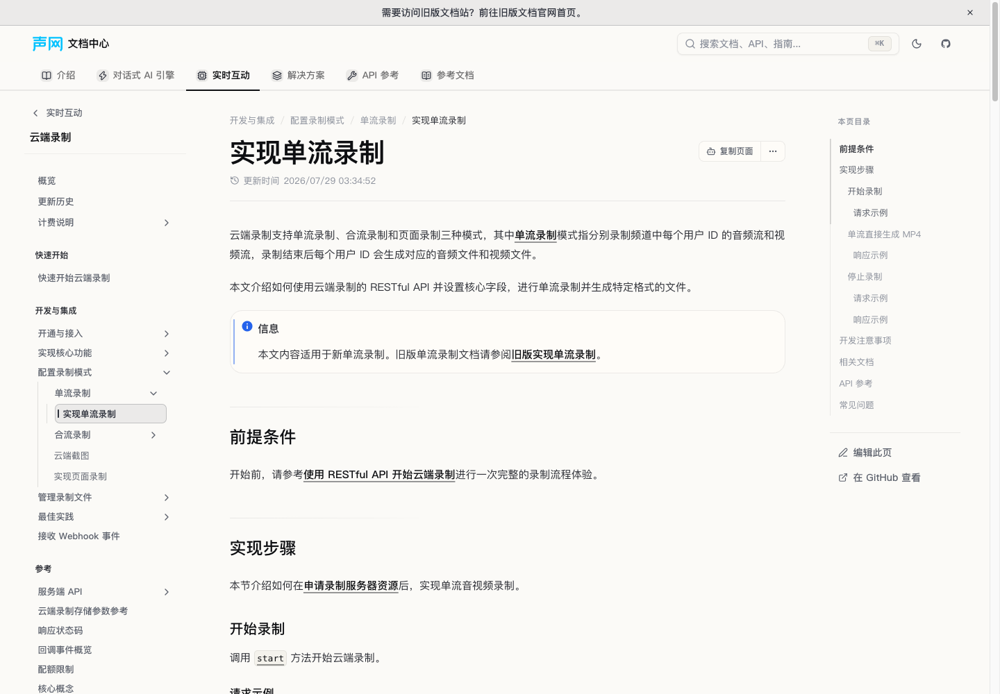
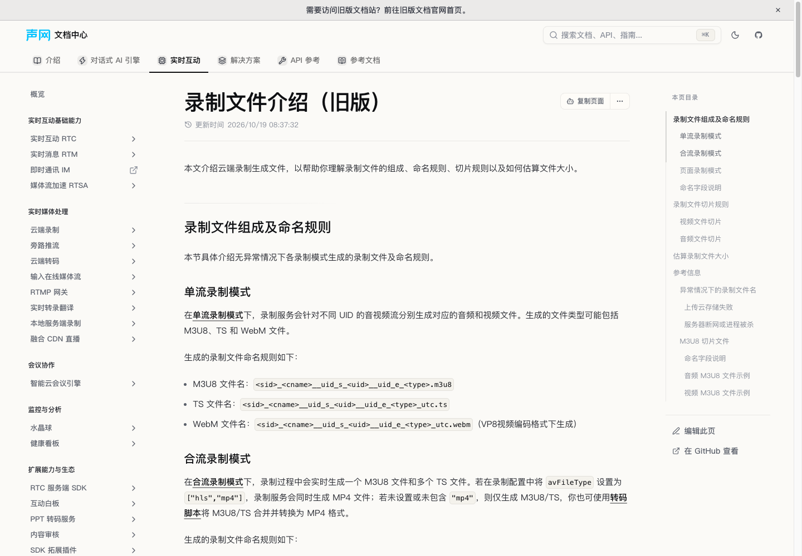

# 云端录制 PR #2091 同步记录

## 来源与范围

- 源 PR：[AgoraIO/shengwang-doc-source#2091](https://github.com/AgoraIO/shengwang-doc-source/pull/2091)。
- 对照源提交：`70ea5b6ab2b46172a27029a5073729f5ea1167aa`，不依赖源仓库后续提交或未提交修改。
- 目标基线：`codex/cn-newdoc-html-api-migration`，`e463c842be`。
- 工作分支：`codex/sync-cloud-recording-pr2091`。
- 仅同步站点内容；不修改录制服务、渲染器、operationId、API URL 前缀或 lane 注册。

## 逐项映射

下表目标路径均相对于仓库根目录。

| 源 PR 文件 | docs-portal 对应内容 | 同步处理 |
| --- | --- | --- |
| `docs-api-reference/cloud-recording/go-api/struct.go.mdx` | `content/docs/zh-CN/api-reference/cloud-recording/go-api/struct.go.mdx` | `MaxVideoDuration` 默认值由 120 改为 180。 |
| `docs/cloud-recording/_en-only/cloud-recording.md` | `content/openapi/cloud-recording/cloud-recording.en.yaml` | 合流 MP4 切分时长改为约 3 小时；页面录制默认值改为 180 分钟。不将中文 raw 模式升级扩展到英文 v1 内容。 |
| `docs/cloud-recording/_sidebar_.meta.js` | `content/docs/zh-CN/realtime-media/cloud-recording/build/recording-modes/individual-mode/meta.json` 与页面标题 | 基线已完成更名和隐藏不转码入口，保持不变。 |
| `docs/cloud-recording/overview/release-notes.mdx` | `content/docs/zh-CN/realtime-media/cloud-recording/reference/release-notes.mdx` | 保留基线已有的 2026.10.08 升级说明，补回两条历史版本的旧版指南链接。 |
| `docs/cloud-recording/user-guides/individual-mode/set-individual.mdx` | `content/docs/zh-CN/realtime-media/cloud-recording/build/recording-modes/individual-mode/set-individual.mdx` | 基线已有 raw、MP4/MP3、MP4 限制和 stranded 说明，补齐旧版入口。 |
| `docs/cloud-recording/user-guides/individual-mode/legacy-set-individual.mdx` | 同目录的 `legacy-set-individual.mdx` | 迁入完整 v1 内容；使用原生 Markdown、Fumadocs tabs、表格 Slot、指令提示框和规范内链。 |
| `docs/cloud-recording/user-guides/manage-file/introduce-recorded-files.mdx` | `content/docs/zh-CN/realtime-media/cloud-recording/build/manage-recorded-files/introduce-recorded-files.mdx` | 基线已有新文件命名和切片规则，补齐旧版入口。 |
| `docs/cloud-recording/user-guides/manage-file/legacy-introduce-recorded-files.mdx` | 同目录的 `legacy-introduce-recorded-files.mdx` | 保留完整旧版命名、切片与 M3U8 示例；规范表格、占位符和内链。 |
| `docs/cloud-recording/user-guides/manage-file/playback.mdx` | `content/docs/zh-CN/realtime-media/cloud-recording/build/manage-recorded-files/playback.mdx` | 基线已完成 3 小时和页面录制配置值说明，保持不变。 |
| `html-docs/cloud-recording/cloud-recording.yaml` | `content/openapi/cloud-recording/cloud-recording.zh-CN.yaml` | 删除 streamMode 定义和四处示例字段，补齐三处 MP4/MP3 示例配置、文件类型说明和 stranded；保留基线已有 raw 与 180 分钟默认值。 |
| `docs/superpowers/plans/2026-09-08-single-stream-mp4-limitations.md` 与 `docs/superpowers/specs/2026-09-08-single-stream-mp4-limitations-design.md` | 不发布为站点页面 | 两份文件为源仓库内部计划和设计记录。 |

旧版页面通过新版页面和历史发版说明访问，不新增主侧栏条目，与源 PR 的导航处理一致。`public/openapi/**` 仅通过同步命令生成，不作为源文件提交。

## 验证

- 新增 `src/lib/cloud-recording-pr2091-sync.test.ts`，9 项回归检查通过；先观察到缺失内容导致的失败，再完成同步。
- 聚焦回归和 OpenAPI 测试：5 个测试文件，62 项通过。
- 完整测试：`bun run test -- --maxWorkers=4 --testTimeout=15000`，221 个测试文件通过，2865 项通过、2 项跳过。
- 默认并发复测曾有一项既有导航测试触发 5 秒超时；该文件单独重跑的 6 项检查通过，限制并发后的完整复测也通过。未修改项目测试配置。
- `bun run types:check` 通过。
- `bun run lint` 通过；新增测试文件的 Biome 检查无诊断。
- `VITE_DOCS_REGION=cn bun run build` 完整通过：生成 6844 份页面数据、8047 份机器可读文件及 7741 个路由 HTML；客户端、SSR 与路由预渲染均成功。构建有 chunk 大小和 Git 历史不完整提示，无构建错误。
- `git diff --check` 通过。
- 两篇旧版页面共 34 个链接、五篇相关产品文档共 134 个链接，经 `auditDocsLinks` 检查均无无效内链。
- 全站链接审计在基线与同步后均报告 190 处无效内链（76 处路径、108 处锚点、6 处相对链接），本次未增加；未扩展修改无关文档。
- `bun run openapi:sync` 后，两种语言的公共 YAML 与维护源一致，且公共副本保持 gitignored。
- 独立审查已完成；修正其发现的旧版参数占位符显示问题。
- 浏览器已验证旧版页面直接可达、新版入口指向正确、命名表格为两列，且页面无横向溢出。
- 中文静态 endpoint payload 抽查：`start.json` 包含 raw 与 MP3、不包含 streamMode；`stop.json` 包含 stranded，证明改动已进入生成页面数据。
- 搜索索引包含更新后的 start endpoint 和旧版指南；机器可读 Markdown 同样包含 MP3/stranded、移除了 streamMode，并保留 OpenAPI operation 来源标记。

## 保留的上游问题

本次以源 PR 的最终内容为准，以下原文问题未擅自更改：

1. 新单流指南称 AV1 可直接生成 MP4，而新文件命名说明称 AV1 不支持生成 MP4。
2. 发版说明称音频场景可直接指定 `mp3`，但指南配置表将单独的 `["mp3"]` 标为不支持。
3. 旧版指南的“开始录制”请求示例仍使用 `acquire` URL；此为源 PR 保留的旧版示例内容。

这些问题需要产品/API 负责人确认，不应在迁移中推断新的产品行为。

## 页面截图

### 新版指南中的旧版入口

### 保留的旧版文件命名

### 更新后的 API 页面

