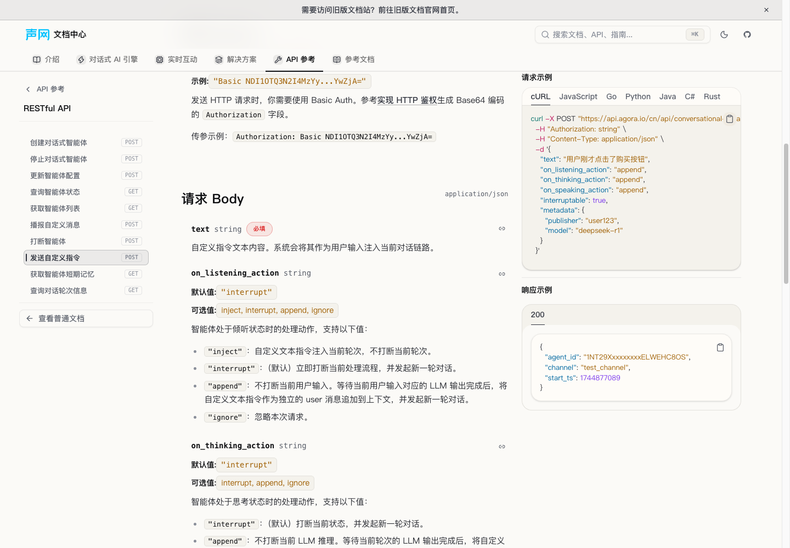
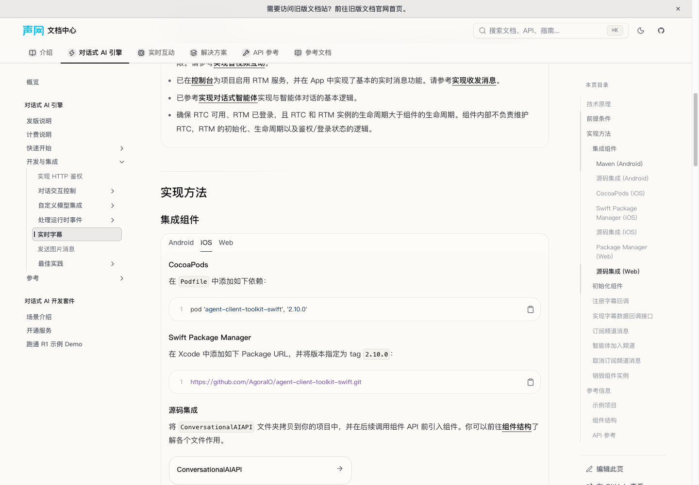

# 源 PR #2074：ConvoAI v2.12 热更新补同步

## 来源、基线与当前状态

- 源 PR：[AgoraIO/shengwang-doc-source#2074](https://github.com/AgoraIO/shengwang-doc-source/pull/2074)。冻结提交：`cf942e1c63405f9330d371c8210e440179fe9608`。
- 来源范围终点：`5d03551cf64cd057ccfe8d5b256d9c4778e8fbb1`；保留其中 #2101 对动态承接词的后续修订。
- 目标基线：`7c6c60ead44406e69906c5c3808cd489784aa89e`；分支 `codex/fix-hotfix-pr2074`。
- 本次内容写集严格为 25 个文件，另新增两个回归测试和本报告。仅修来源有效 hunk，不修改 runtime、lanes、元信息、英文或锁文件。
- 当前轻量验证与主控批准的独占完整测试均已完成。严格 OpenAPI schema 校验存在基线已有问题，见文末；构建与浏览器验收留给主控，未自行启动。

## 23 个源文件到目标的完整映射

表中 `API/` 指 `content/docs/zh-CN/api-reference/conversational-ai/`；`AI/` 指 `content/docs/zh-CN/ai/`。表内源路径均相对于 shengwang-doc-source 根目录。

| 源文件 | 目标与处理 |
| --- | --- |
| `docs-api-reference/convoai/agent-sdk-api/overview.agent-go.mdx` | `API/agent-go/index.mdx`：WithTools/Tools/公开类型/承接词术语均已有；append 与回退已被 #2101 正确覆盖，不改。 |
| `docs-api-reference/convoai/agent-sdk-api/overview.agent-python.mdx` | `API/agent-python/index.mdx`：补两处术语、公开别名、think 三状态 append 示例、模板序列化/占位符说明、CustomLLM 两个参数。保留现有 #2101 正文和 `asr.keywords`。 |
| `docs-api-reference/convoai/agent-sdk-api/overview.agent-typescript.mdx` | `API/agent-typescript/index.mdx`：补两处术语、公开生成配置/工具类型别名、LLM tools 参数及共享开关说明。 |
| `docs-api-reference/convoai/android-component/iconversationalaiapi.android.mdx` | `API/android/iconversationalaiapi.mdx`：完整恢复 speak/think 参数、completion 成败及非处理完成语义。 |
| `docs-api-reference/convoai/android-component/struct.android.mdx` | `API/android/struct.mdx`：补 SpeakMessage/ThinkMessage 成员表的默认值、链接、metadata=null 不写 RTM 语义。 |
| `docs-api-reference/convoai/android-component/enum.android.mdx` | `API/android/enum.mdx`：三种新增动作枚举及用途已齐，不改。 |
| `docs-api-reference/convoai/android-component/overview.android.mdx` | `API/android/overview.mdx`：补 speak/think 两行 canonical 链接。 |
| `docs-api-reference/convoai/ios-component/conversationalaiapi.ios.mdx` | `API/ios/conversationalaiapi.mdx`：恢复 RTM 用户 ID 唯一性、Swift completion 类型、nil/错误结果及非处理完成声明。 |
| `docs-api-reference/convoai/ios-component/struct.ios.mdx` | `API/ios/struct.mdx`：补完整成员表；修正 Bool、[String: String]? 类型、默认值和 nil 不写 RTM。 |
| `docs-api-reference/convoai/ios-component/enum.ios.mdx` | `API/ios/enum.mdx`：已齐，不改。 |
| `docs-api-reference/convoai/ios-component/overview.ios.mdx` | `API/ios/overview.mdx`：补 speak/think 两行 canonical 链接。 |
| `docs-api-reference/convoai/web-component/conversationalaiapi.typescript.mdx` | `API/web/conversationalaiapi.mdx`：补初始化 rtmEngine 前提及 Promise 成功不代表播报/LLM 处理完成。 |
| `docs-api-reference/convoai/web-component/struct.typescript.mdx` | `API/web/struct.mdx`：恢复 SpeakMessage/ThinkMessage 两张完整成员表。 |
| `docs-api-reference/convoai/web-component/enum.typescript.mdx` | `API/web/enum.mdx`：保留已有值映射，补三种状态的用途说明。 |
| `docs-api-reference/convoai/web-component/overview.typescript.mdx` | `API/web/overview.mdx`：补 speak/think 两行 canonical 链接。 |
| `docs/convoai/_sidebar_.meta.js` | `AI/build/shape-the-conversation/meta.json`：两篇新指南已列入，不改。 |
| `docs/convoai/overview/release-notes.mdx` | `AI/release-notes.mdx`：v2.12 全文、21 个三端 API 链接、下线表已覆盖；仅补历史版本两处垫词→承接词 hunk。 |
| `docs/convoai/user-guides/rest-tool.mdx` | `AI/build/shape-the-conversation/rest-tool.mdx`：终点 14/14 代码块逐字存在，有效正文仅标题同义简化，不改。 |
| `docs/convoai/user-guides/filler-words.mdx` | `AI/build/shape-the-conversation/filler-words.mdx`：终点 8/8 代码块逐字存在，102 个较长表格单元语义均在；复杂内容已正确拆为 Slot，不改。 |
| `docs/shared/convoai/component-integrate.mdx` | 六个源实际消费者映射到 11 个目标页面，十处展开副本局部更新五种安装方式；transcripts 恢复缺失的包安装选项。详见下表。 |
| `docs/shared/convoai/component-structure.mdx` | 实际目标展开仅 `AI/build/transcripts.mdx`；补 MessageModels.swift、MessagePayloadBuilder.swift，并收窄 ConversationalAIAPI.swift 的描述。 |
| `docs/superpowers/specs/2026-08-25-convoai-v2-12-restful-toolkit-pr-design.md` | 内部设计记录，不属于门户用户内容，排除。 |
| `html-docs/convoai/RESTful/convoai.yaml` | `content/openapi/conversational-ai/rest-api.zh-CN.yaml`：全量核对 292 增加/82 删除；43 个有效变更叶子仅 think 的 12 个未覆盖，本次只补这 12 个。 |

## 共享安装闭包与实际写集

| 源 `<Integrate/>` 消费者 | canonical 目标 | 同内容 API 参考目标 |
| --- | --- | --- |
| `docs/convoai/best-practice/audio-settings.mdx` | `AI/build/harden-and-optimize/audio-setup.mdx` | `API/rest-api/best-practice/audio-settings.mdx` |
| `docs/convoai/user-guides/interrupt-agent.mdx` | `AI/build/shape-the-conversation/interrupt-agent.mdx` | `API/rest-api/user-guides/interrupt-agent.mdx` |
| `docs/convoai/user-guides/listen-agent-events.mdx` | `AI/build/handle-runtime-events/event-notifications.mdx` | `API/rest-api/user-guides/listen-agent-events.mdx` |
| `docs/convoai/user-guides/manual-turn-control.mdx` | `AI/build/shape-the-conversation/manual-turn-control.mdx` | 无 |
| `docs/convoai/user-guides/realtime-sub.mdx` | `AI/build/transcripts.mdx` | `API/rest-api/user-guides/realtime-sub.mdx` |
| `docs/convoai/user-guides/send-multimodal-message.mdx` | `AI/build/send-multimodal-messages.mdx` | `API/rest-api/user-guides/send-multimodal-message.mdx` |

除 transcripts 外，十个目标都有五种安装方式的旧版本。只在从 Maven 依赖到 React 双包命令的安装区间内修改五行：Maven、CocoaPods、SPM tag、Vanilla 包、React 双包；区间外整篇不变，不做全局 2.9.0 替换。

transcripts 原先仅有源码方式。主控明确批准在现有 Android/iOS/Web 三个 TabsContent 中恢复对应包安装方式，使用 Markdown 小标题和已有支持语言的围栏，不新增嵌套平台组件。原手动源码流程和三个 Card URL 均保留；Maven 围栏用受支持的 text，Web 用 bash。

源 component-structure 虽有五处 import，但冻结提交未实际调用 Structure；目标真正结构列表只在 transcripts。未给其他十页生造结构副本。

25 个内容文件构成为：两个 Agents SDK、十个客户端文件、一个 release-notes、十个安装展开副本、一个 transcripts、一个中文 YAML。测试文件为 `src/lib/convoai-pr2074-sync.test.ts`（27 条）与 `src/lib/convoai-pr2074-client-sync.test.ts`（18 条）。

## 保留的平台差异与后续依赖

| 合同 | Speak priority 默认值 | Think listening/thinking/speaking 默认值 |
| --- | --- | --- |
| Android 客户端 | INTERRUPT | INTERRUPT / IGNORE / IGNORE |
| iOS 客户端 | .interrupt | .interrupt / .ignore / .ignore |
| Web 客户端 | INTERRUPTED | INTERRUPT / IGNORE / IGNORE |
| REST think | 不适用 | interrupt / interrupt / ignore |

- Android completion 成功 error=null、失败非 null；iOS 成功 nil、失败错误信息；两者只代表 RTM 发布结果。Web 需初始化 rtmEngine，Promise 成功也只代表发布成功。
- Android/iOS metadata 为 null/nil 时不写入 RTM 消息。不得把 iOS 表格类型沿用为 Kotlin 的 Boolean/Map，也不统一客户端与 REST 的 thinking 默认值。
- #2074 新增的 Python/TypeScript 公开别名段落本次各补一次，使用终点措辞。后续 #2101 不再重复添加这些段落，只补其自身遗漏的 TypeScript 上下文字段等内容。
- Go 不改；当前 #2101 的静态回退必须配置、20 词/字符、上下文范围、Think 常量均保留。TypeScript 已有 generatedConfig 拼写差异留给 #2101，不整段重抄回旧模式。
- 两个 FengmingSTT 小节与本基线逐字相同，不夹带未合并 #1221 的 Python 表归属/完整描述或 TypeScript 热词修复；Python 已有 `asr.keywords` 不倒退。
- 源 rest-tool 的 Python 模板表存在 body/headers 与 args 的概括歧义，当前指南忠实保留且不在本次改写 SDK 事实。
- 原 #2074 承接词文档的静态回退可选、50 词、trigger.mode 和 fallback_strategy 已被 #2101 更新，不可恢复。

## 红绿与验证记录

1. `bun install --frozen-lockfile` 成功，锁文件未变。
2. 正文修改前，既有 `source.server`、OpenAPI source/lanes/source-text/markdown 五个测试文件：57/57 通过。
3. 先新增两个基于真实 MDX 段落、平台、成员表及 parsed YAML 的测试文件，初轮 45 条失败。安装定位需兼容 API 副本的嵌套 Tabs，Python Optional 类型期望也校准为方括号；校准后分别重新确认十个安装用例、一个术语用例因实际缺口失败，再补最小正文，不把定位错误当缺口证据。
4. 最小补齐后两个新文件 45/45 通过。客户端 18 条覆盖 overview 六链接、六方法、六结构表和三个 Web 枚举用途；其余 27 条覆盖 SDK、共享安装、结构、历史术语及 REST 三 action/示例。
5. 最终定向命令覆盖两个新文件，以及 OpenAPI source/lanes/source-text/markdown/fumadocs-source、docs-content-regressions：8 文件、187/187 通过。
6. `bun run types:check` 成功；仅对两个新测试执行 Biome check，成功。
7. 使用 `analyzeMdxBuildSyntax` 检查全部 24 篇改动 MDX：0 问题；使用 source.config 实际 `mdxOptions('bundler')` 编译每篇去 frontmatter 的完整正文：全部成功，共输出 4573104 字符。存在 Shiki 多实例提示，未因此修改 runtime。
8. 自审脚本对 25 个内容文件逐一撤去允许区间内修改并比较基线：区间外逐字一致；两个 Fengming 小节完全不变；YAML 恰好 12 个叶子变化且全属于 think，其他 YAML 语义与基线相同。
9. 检查新增 Markdown 行中 25 条内部链接及锚点：全部有效，其中一条 OpenAPI 虚拟 endpoint 通过真实 lane registry 解析，不要求不存在的 MDX shadow 文件。
10. `bun run openapi:sync` 成功；生成目录 public/openapi 被忽略，没有 tracked 变动。
11. `git diff --check` 成功。
12. 主控批准后的独占完整 `bun run test --maxWorkers=4`：退出 0；223 个测试文件通过，2910 条通过、2 条跳过（共 2912 条），耗时 82.30 秒。未修改既有断言或 timeout。控制台有既有 localstorage、Happy DOM 禁载脚本与 socket hang up 信息，最终无失败汇总。

### 严格 OpenAPI 校验的既有问题

对基线和当前分别执行 SwaggerParser.validate，二者均因 `components.securitySchemes` 中已有的 `Basic Auth` 键名包含空格、不符合 `^[a-zA-Z0-9._-]+$` 而失败。该字段未被本次修改。

对两者执行 `validate(..., { validate: { schema: false } })` 则均可通过引用/非 schema 校验，均有 10 个 path。**关闭 schema 校验不等于严格校验通过**。本报告不将严格校验标为成功，也不扩大范围去修改 scheme、operationId 或 lanes；该基线问题已反馈主控。

Vitest 有既有 localstorage 路径警告。主控后续构建与浏览器验收结果如下；严格 schema 的既有失败仍保留，不因页面成功而标成通过。

## 主控独立审查与组合生产验收

- 独立规格审查逐一核对源23文件、43有效YAML叶子及两个完整指南；规格通过。另一独立质量审查无Critical/Important/Minor；45项新测试、Biome和diff检查通过。主控也独立复跑两个新文件，45/45通过。
- 主控独立验证树从固定基线逐项cherry-pick前十个修复及本项，无冲突；含本项的验证HEAD为 `f452f84662`。该组合包含源2063的独立修复，但本分支没有夹带它。
- 在组合树执行 `VITE_DOCS_REGION=cn bun run build`，完整退出码0：静态6844份payload、8047份机器可读文件、客户端与SSR打包、全站预渲染及7741份路由HTML全部完成。Git历史不完整时last-updated脚本保留原manifest，未将旧更新时间展示误称本次日期刷新；构建有既有大chunk提示，不宣称没有警告。
- 实际生成 `/zh-CN/api-reference/api-ref/conversational-ai/think.md` 含三action的append说明、完整enum和默认interrupt/interrupt/ignore及三append示例；字幕Markdown含Maven/Pods/SPM/Vanilla/React五种2.10.0安装和两个Swift新结构文件。维护YAML、生成payload、可读Markdown与页面相符。
- 静态构建预览的正确命令为 `DOCS_BUILD_TARGET=static VITE_DOCS_REGION=cn bun run preview --host 127.0.0.1 --port 4307 --strictPort`。首次默认preview误走Nitro，另一次多传 `--outDir dist/client` 使TanStack查找错误server路径；对照实际配置/产物后仅修正验收调用，不修改项目配置或运行时。
- 使用agent-browser隔离会话检查本地构建产物。安装自带Chrome150的截图CDP超时，改用本机Chrome154的独立临时会话后截图成功；没有连接用户浏览器、读取登录态或调用真实业务API。普通ref-click未切换Radix标签，使用实际鼠标事件后iOS/Web切换及可见panel均确认；首轮Web校验误匹配隐藏iOS中的Swift Package Manager，改为可见panel定位后通过，不改正文。
- 浏览器确认think三字段各自默认值、可选append和完整请求示例；三客户端Speak/Think真实表格的类型、metadata、各平台默认值正确；字幕Android Maven、iOS Pods/SPM、Web Vanilla/React安装与源码替代项可见。上述页面document横向溢出均为false，最后会话无捕获到的页面错误。专用会话和预览随后关闭，未部署。

浏览器证据（组合构建，不代表已合入或线上）：

