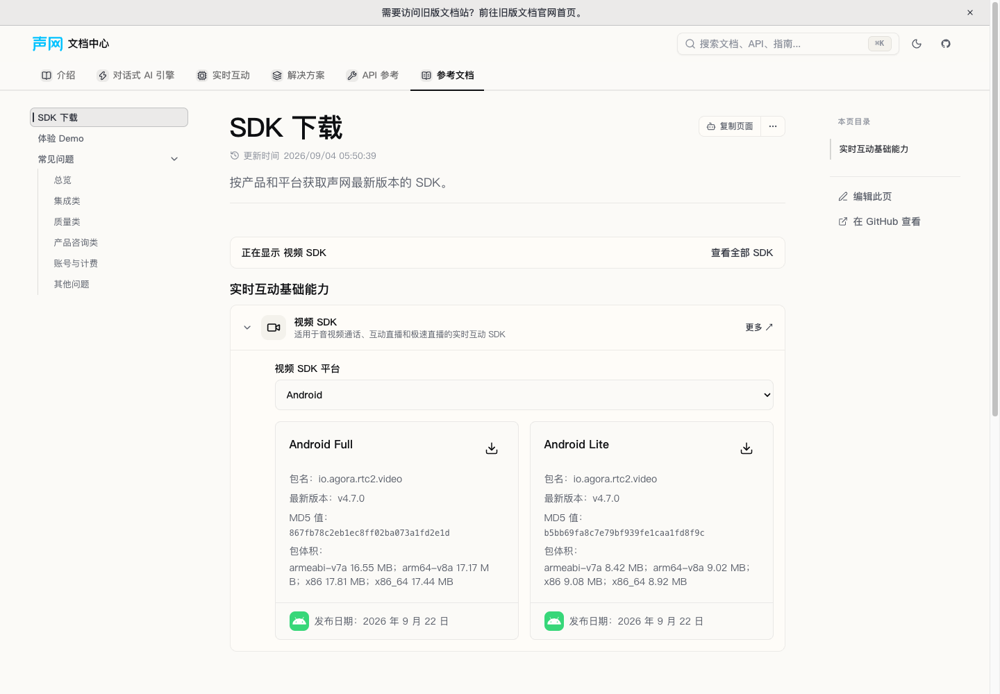
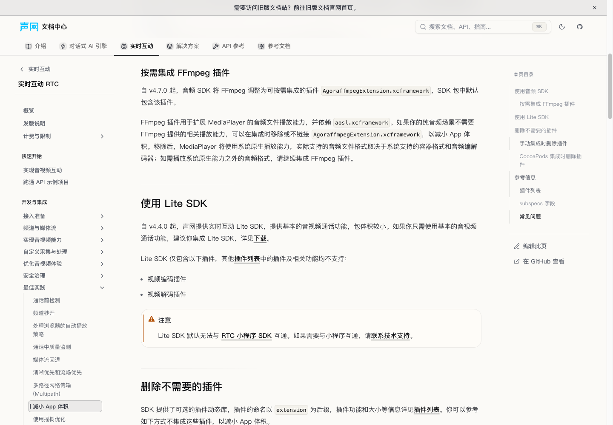

# 源 PR #2098：RTC Native 4.7.0 指南与下载目录同步

## 主控最终验收补记

完整15源文件规格审查通过；独立质量审查的唯一Minor为测试边界，已在`e22b315065`修复并独立复核，最终Critical/Important/Minor均0。生产仍为`1b9e4de418`的8文件，新守卫后25项回归及相关108项通过；原standalone full为pre-Minor的真实记录，见下文，不追认旧完整测试覆盖新守卫。

主控在十四项组合树继承最终测试，生产内容HEAD`edf95162a6`。仅Android发版首部与#1224发生预期文本冲突，保留CDN caution在前、包名迁移caution在后，均在首版本前；减包指南与共享SDK数据自动合并。主控运行7组合定向文件165项通过（两新边界及最后补卡之前），最终组合完整测试另记。独立修复PR合并时同样须同时保留两段提醒，不整块选择一侧覆盖。

中文范围开发预览使用 `VITE_DOCS_REGION=cn DOCS_DEV_SCOPE=zh-CN bun run dev --host 127.0.0.1 --port 4307 --strictPort`，不是本分支生产build。隔离agent-browser Chrome154会话验证：

- 实际统一目录`?product=video&platform=android`展开后，Full/Lite卡均显示4.7.0、源MD5、体积及2026年9月22日；未触发真实下载。
- iOS减包页的`#按需集成-ffmpeg-插件-ios`命中可见H3，显示AgoraffmpegExtension.xcframework、aosl.xcframework及系统原生播放fallback。Android美颜页显示源4.7.0/4.5.x与4.6.x分界及人脸检测用途。
- 组合Android发版页首版本前两条caution均实际可见；所有受检页面document横向溢出false。最终会话无捕获页面异常；开发日志有class/className提示和HMR重载，不宣称完全无警告。
- 专用浏览器和开发服务器随后关闭，无scope类型生成与最终组合完整测试正在执行。本项及后加三项未重复生产build，不能使用前十一项构建结果冒充本项已构建；未合入或部署。





## 状态与固定来源

状态：`READY_WITHOUT_FULL`。本分支完成轻量验证和本地提交；未运行完整测试、生产构建或预览，也未推送或创建 PR。完整测试、独立审查及与 #1224 的组合验收由主控调度，不能据此宣称线上已生效。

- 源提交：`7c18a97504d2ffdd2d5eb00bca979735ec87c5f7`（`AgoraIO/shengwang-doc-source#2098`）。
- 源范围终点：`5d03551cf64cd057ccfe8d5b256d9c4778e8fbb1`。
- 目标基线：`7c6c60ead44406e69906c5c3808cd489784aa89e`。
- 完整读取源 15 文件 diff；这些路径从源提交到终点的 `git log` 为空，`git diff --quiet` 退出 0，无后续源覆盖或回退需要排除。
- 源仓库只读 Git 对象；未读取或修改源工作区、未提交文件和环境文件。
- 按批准计划修改 8 个生产文件，新增本项回归测试和报告；另有主控批准的既有测试两项预期更新，见验证记录。

## 全部 15 个源文件的有效 hunk 承接

以下 `RTC/` 表示 `content/docs/zh-CN/realtime-media/rtc/`。

| 源文件 | 目标承接与处理 |
| --- | --- |
| `docs-faq/audio-format.mdx` | `content/docs/zh-CN/reference/faq/product/audio_format.mdx`：Android 基础单音轨列表删除 ASF、AVI、WMA；扩展解码器表 ARM/FALC 修正为 AMR/FLAC；Android Lite 的原生媒体能力及 WMA 条件合并，删除旧无条件 WMA 失败提示。Windows WMA、扩展容器格式、iOS Lite、3GP 设备兼容性和 MP4 第二音轨限制不变。 |
| `docs/rtc/_homepage_.mdx` | 源更新 iOS、macOS/Windows 三组最新版本/日期行。目标首页已经改为平台入口、下载和参考信息卡片，按批准边界不恢复旧组件。现有首页的下载入口实际进入统一目录，因此同步其 Native 4.7.0 数据，而非新增 UI。各平台最新发版事实由已有发版正文承接。 |
| `docs/rtc/advanced-features/advanced-beauty.windows.android.ios.macos.mdx` | `RTC/build/video/advanced-beauty.mdx`：四平台版本选择、前提条件和 string 方法可用范围共 12 处旧限制更新为源精确范围；Android/iOS 方法列表增加人脸检测用途；四平台共有 Detail 增加置信度介绍。签名、参数、返回值及其他美颜 API 不改。 |
| `docs/shared/rtc/new-beauty-intro.mdx` | 展开至 `RTC/build/video/advanced-beauty-460.mdx` 的 Android/iOS/macOS/Windows 四块。开头与前提限制为 v4.6.x，更新免费措辞及 2.1/2.0/Legacy 三路选择；原有基础美颜直接调用 API、美妆需获取合适 SDK/素材的条件保留。 |
| `docs/rtc/get-started/quick-start.android.mdx` | `RTC/get-started/quick-start.mdx`：只替换 Android 防混淆步骤，完整保留源的未开启 R8/ProGuard 无须配置、快速 keep、JNI 精细规则、AAR 自动生效、JAR 手动复制及 Gradle 示例。集成 SDK 小节与其他平台不改。 |
| `docs/rtc/basic-features/audio-quick-start.android.mdx` | `RTC/build/audio/audio-quick-start.mdx`：与视频快速开始相同的 Android 防混淆替换，其他内容不改。 |
| `docs/rtc/best-practice/reduce-app-size.android.ios.macos.windows.electron.mdx` | `RTC/build/optimize-and-operate/reduce-app-size.mdx`：Android/iOS 各增加按需 FFmpeg 小节；Android 只替换音频 SDK 核心库条目；iOS 音频 subspecs 条目在 iOS/macOS 两份共享展开中同步。视频库名和其他平台教程不做全局替换。 |
| `docs/rtc/overview/release-notes.android.mdx` | `RTC/reference/release-notes.mdx`：已有 v4.7.0 主体完整，不重抄；只补 Android 所有版本之前的 caution，说明升级至 v4.6.0 及以上时 Maven 包名须迁移。源顶部 CDN 说明由 #1224 承接，本分支不重复引入，组合依赖见下节。 |
| `docs/rtc/overview/release-notes.ios.mdx` | 同一发版文件 iOS 分段的 v4.7.0 主体已覆盖，正文与链接保持；源新增空行不机械同步。 |
| `docs/rtc/overview/release-notes.macos.mdx` | 同一发版文件 macOS 分段的 v4.7.0 主体已覆盖，保持原样。 |
| `docs/rtc/overview/release-notes.windows.mdx` | 同一发版文件 Windows/C++ 分段的 v4.7.0 主体已覆盖，保持原样。 |
| `docs/rtc/resources.android.mdx` | `RTC/reference/downloads/android.mdx` 的三个 Gradle 4.7.0 依赖已正确；专用数据三个下载包的 URL/MD5/体积/日期已正确。下载正文与专用数据不改，仅将正确八包中的 Android 三包镜像到统一目录。 |
| `docs/rtc/resources.ios.mdx` | `RTC/reference/downloads/ios.mdx` 的五条 CocoaPods、三条 SPM 版本及专用数据三包元数据已正确；保持原样，统一目录镜像 iOS 三包。 |
| `docs/rtc/resources.macos.mdx` | `RTC/reference/downloads/macos.mdx` 的两条 CocoaPods、一条 SPM、专用下载版本/URL/日期已正确；保持原样，统一目录镜像 macOS 包。源末尾换行不是额外内容缺口。 |
| `docs/rtc/resources.windows.mdx` | `RTC/reference/downloads/windows.mdx` 的专用下载版本/URL/日期已正确；保持原样，统一目录镜像 Windows 包。 |

四平台发版主体已逐段核对：Android 17、iOS 16、macOS 11、Windows 13 条正文均存在；另核对 13、12、7、8 个标题也均存在。正确发布日期为 **2026 年 9 月 22 日**，不回退到早期草稿日期或旧版本。

## 版本、平台及组合边界

- 美颜 2.1 条件严格为“v4.7.0，或 v4.5.x 中 v4.5.2.9 及以上”，没有擅自改成所有 `>=4.7.0`；2.0 仅 v4.6.x，Legacy 低于 v4.5.2.9。
- Maven 包名迁移与 Java 类名不同；防混淆规则仍保留 `io.agora.**`，不替换成 cn.shengwang 类名。
- 新 Gradle 示例正文与源一致，使用目标配置支持的 `text` 代码 fence 承载 Groovy DSL，不增加语言或运行时依赖。
- Android/iOS FFmpeg 章节保留默认包含但可移除/不链接、依赖 `libaosl.so` / `aosl.xcframework`、原生播放 fallback，以及需要额外格式时继续集成插件的条件。
- iOS 音频表在 macOS 分段内也有共享子 tab，等价更新该表不是宣布 macOS 新功能；macOS 不增加 FFmpeg 教程标题。Android 视频表的 `libagora-ffmpeg.so`、iOS/macOS 视频表的 `Agoraffmpeg.xcframework` 保持。
- 两个新 FFmpeg 标题采用 Fumadocs 原生稳定 ID：`按需集成-ffmpeg-插件-android`、`按需集成-ffmpeg-插件-ios`。表格链接带对应 `?platform=android` / `?platform=ios`，避免重复标题产生错误平台跳转。
- 与 #1224 的发版说明插入点可能发生文本冲突，须由主控组合收口，保留其 CDN caution、日期、下载规范锚点和本项包名前提；减包文档需同时保留 #1224 的仓库前置段。本分支基于固定基线，未重复引入 #1224 补丁，组合验收尚未执行。
- 两份快速开始的 Android `## 集成 SDK` 及之后内容与固定基线逐字节一致，双 CDN 配置与 `mavenCentral()` 未被覆盖。发版正文从首个 v4.7.0 标题起的全部后续内容逐字节一致。
- 源 15 文件不含 archive/platform meta，不增加归档选择器或版本目录；不修改英文、运行时、组件 UI、锁文件、其他产品平台和正确的专用下载数据。

## 两条实际下载消费链与源数据证据

专用产品下载页经 `RtcSdkDownloads` 消费 `rtc-sdk-downloads-data.zh-cn.ts`；现有 RTC 首页下载入口则进入 `SdksCatalog`，消费 `sdk-downloads-data.zh-cn.ts`。后者原先 Native 最新停留在 Android 4.6.3、iOS/macOS/Windows 4.6.2，本次只同步其四个平台中的六个 RTC 产品、八个新版本对象。

八个源 URL 均使用前缀 `https://download.shengwang.cn/sdk/release/`：

```text
Shengwang_Native_SDK_for_Android_v4.7.0_FULL.zip
Shengwang_Native_SDK_for_Android_v4.7.0_LITE.zip
Shengwang_Native_SDK_for_Android_v4.7.0_VOICE.zip
Shengwang_Native_SDK_for_iOS_v4.7.0_FULL.zip
Shengwang_Native_SDK_for_iOS_v4.7.0_LITE.zip
Shengwang_Native_SDK_for_iOS_v4.7.0_VOICE.zip
Shengwang_Native_SDK_for_Mac_v4.7.0_FULL.zip
Shengwang_Native_SDK_for_Windows_v4.7.0_FULL.zip
```

| 源包 | MD5 | 集成体积 MB |
| --- | --- | --- |
| Android Full | `867fb78c2eb1ec8ff02ba073a1fd2e1d` | armeabi-v7a 16.55；arm64-v8a 17.17；x86 17.81；x86_64 17.44 |
| Android Lite | `b5bb69fa8c7e79bf939fe1caa1fd8f9c` | armeabi-v7a 8.42；arm64-v8a 9.02；x86 9.08；x86_64 8.92 |
| Android Voice | `acb70a13f5e001e324cb33e46624edf8` | armeabi-v7a 7.27；arm64-v8a 7.82；x86 7.67；x86_64 7.49 |
| iOS Full | `044dafd641e8d44b9e2583c5481aeaa8` | 31.69 |
| iOS Lite | `c29b295befc44fe4ab5023e166e93e41` | 14.97 |
| iOS Voice | `db7fc92f1f56725758a5d71173e9fcab` | 13.15 |

8 URL、6 MD5、15 体积值和 2026-09-22 发布日期均与固定源及未改动的正确专用数据对应。macOS/Windows 源没有 MD5/体积，不补造。

保留全部 **140 个历史 Native 版本对象**，仅将十个旧“最新”标签和两个旧 Lite `latestVariant` 标记降为历史；其中两个旧通用 video 别名也带“最新”，因此标签数多于八包。旧 URL、MD5、体积、包名、日期和包管理器信息不删除。新 4.7.0 对象不继承旧 4.6.3 Central 链接，也不猜新 Central URL。对基线模型逐项比较证明其余产品、平台及历史字段未改变。

## 轻量验证与真实失败记录

- `bun install --frozen-lockfile` 成功，锁文件未修改。
- TDD：先新增 `src/lib/rtc-pr2098-sync.test.ts`，23 项检查均因真实缺口失败；补齐后 23/23 通过。检查按各平台/章节/子表分别取正文，并包含四个平台真实 `SdksCatalog` 服务端渲染消费者，不以全文同名关键词替代平台覆盖。
- 既有专用下载组件基线：`RtcSdkDownloads.test.tsx`，29/29 通过。
- 首次三文件定向命令得到 **105 项通过、1 项失败**：`SdksCatalog.test.tsx` 的 Chinese metadata case 仍期待 Android Voice 4.6.3 的旧 MD5 `2801dfea3c96a32e6aaaa354d819ec71` 和 2026-02-09；真实 DOM 已显示源 4.7.0 的 `acb70a13f5e001e324cb33e46624edf8` 与 2026-09-22。没有修改生产数据迎合旧断言。
- 主控批准测试写集例外，仅更新该 case 的上述 MD5、日期两项预期；英文、其他产品和其他断言不动。协调计划同步记录了该例外，新增 23 项 TDD 检查保留。
- 以同一命令复验：`bun run test src/lib/rtc-pr2098-sync.test.ts src/components/docs-overview/RtcSdkDownloads.test.tsx src/components/docs-overview/SdksCatalog.test.tsx --maxWorkers=2`，3 个文件、106 项测试全部通过，退出码 0。
- `bun run types:check` 通过。
- 对新增测试、共享目录数据和获准更新的既有测试执行 Biome，3 文件通过；`git diff --check` 通过。
- 七份修改 MDX 全文实际编译通过，使用项目已有 GFM、directive/admonition 和原生 heading 插件。新 FFmpeg ID 确认在真实 h3 上，平台链接保留；减包文档 TOC 除两个新 ID 外与基线逐项一致，其余旧标题和全部旧显式锚点保留。
- 七文件静态语法检查：六文件 0 问题；视频快速开始保留一条基线已有提示，位于 React 分段 iframe 的合法 `style={{...}}` 对象（修改后第 8461 行）。忽略新增内容引起的行号移动后检查结果与基线完全一致，该全文实际编译成功，不扩大修改。
- 三条新本地链接均确认真实文件存在；两个 FFmpeg fragment 与实际编译后的标题 ID 一致，iOS 链接明确选中 iOS。其余新美颜跳转指向现有 2.1 页面。
- 七 MDX 与固定基线逐字节比对，仅包含显式批准的源变换；未修改的平台分段、既有集成配置和发版主体保持。目录数据模型的历史/非目标保护检查通过。

完整测试、build、preview、浏览器视觉检查及 #1224 组合验收均未执行，交由主控后续独占调度。`READY_WITHOUT_FULL` 不等于整库测试或生产发布通过。

## 轻量交付后的独占完整测试记录

前文 `READY_WITHOUT_FULL` 及“完整测试未执行”记录的是初次轻量提交时的状态；本节追加其后主控放行的完整测试结果，不覆盖此前真实失败和修订证据。

- 测试代码提交：`1b9e4de418c033e8570046a7a198302e530a180c`。
- 在本工作树独占执行 `bun run test --maxWorkers=4`，自然结束，退出码 **0**。
- **222 个测试文件通过，2888 项测试通过、2 项跳过，共 2890 项**；耗时 **83.50 秒**。
- 本轮没有修改生产内容、回归测试、既有测试或超时设置，没有启动 build/preview，也没有并发重跑完整测试。
- 输出中仍有 Node `--localstorage-file`、`ECONNRESET` 和 happy-dom 禁止加载本地脚本的诊断；保留这些边界，以最终测试汇总和退出码确认本轮无失败。
- 测试结束后立即通知主控释放验证窗口，此后仅追加本报告并提交。

本轮只补充独立分支的完整测试证据。**spec/quality 审查仍进行中，#1224 组合验收、构建、浏览器检查、推送、PR 和线上生效均不因本轮结果自动成立；不得记为整体验收全部通过。**

## quality Minor 修复：测试提取边界

评审指出，原防混淆检查的 `split` 在结束标题缺失时会把后文一并纳入；发版前缀的 `slice(0, indexOf(...))` 在版本标题缺失时会接受 `-1`，仍可能从错误范围找到关键词。本次只修改测试与报告，不改任何生产文件。

- 为起止提取增加显式 start/end 存在和先后校验；版本前缀单独断言结束索引 `>=0`，再执行 slice。
- 平台正文提取要求该平台恰有一个匹配块，不再用 find 接受重复平台块。
- 新增两个使用真实正文内存变体的测试：移除章节起点/终点、颠倒两者、移除首版本标题，以及重复/移除真实 Android 平台块。没有改写磁盘正文。
- RED：保留原提取行为时，新两项因未拒绝缺失结束标记而失败，原 23 项通过；GREEN：增加 guard 后，本项 25 项及两个相关既有测试文件共 **108/108** 通过，命令仍为上文三文件定向命令。
- `bun run types:check`、新增测试文件 Biome 和 `git diff --check` 通过；本次未运行 full/build/preview，也未更改超时或其他测试。

上节 222 文件、2888 通过/2 跳过的独占 full 是 **Minor 修复前提交 `1b9e4de418c033e8570046a7a198302e530a180c`** 的事实记录，不能追认覆盖新增两个 guard 测试。本次改动待 reviewer 复核，最终组合 full 由主控安排。
