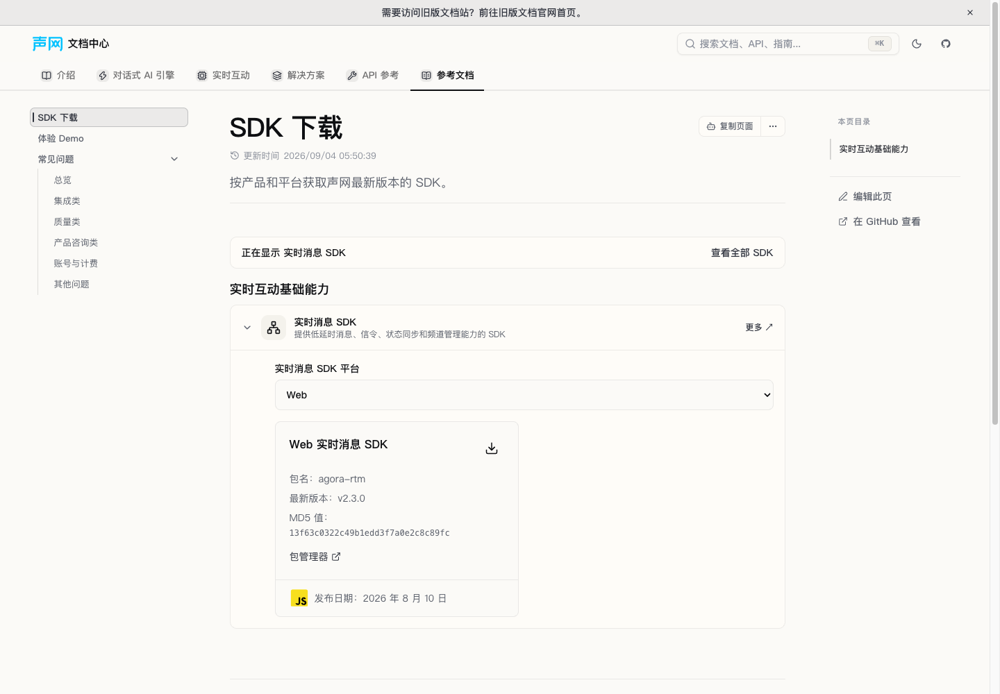
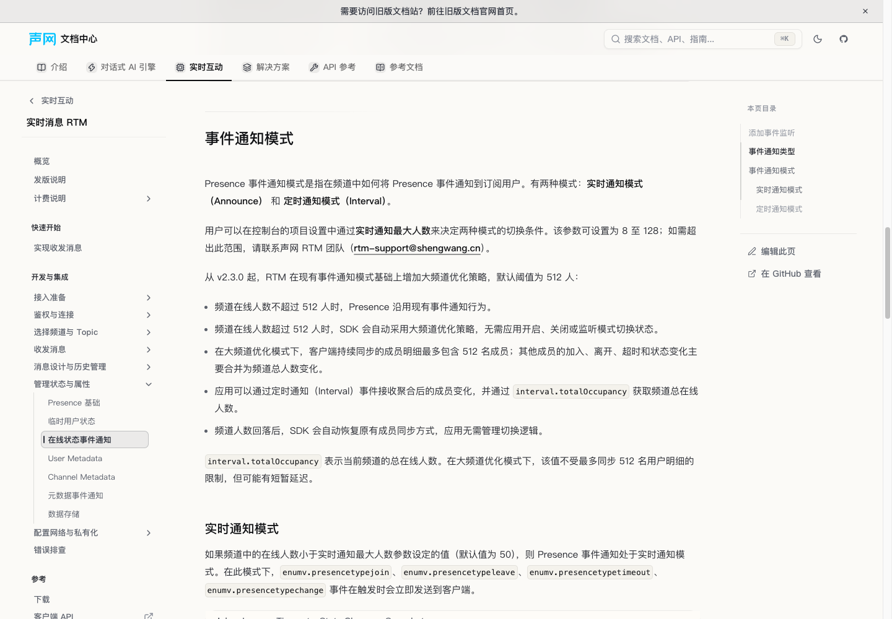
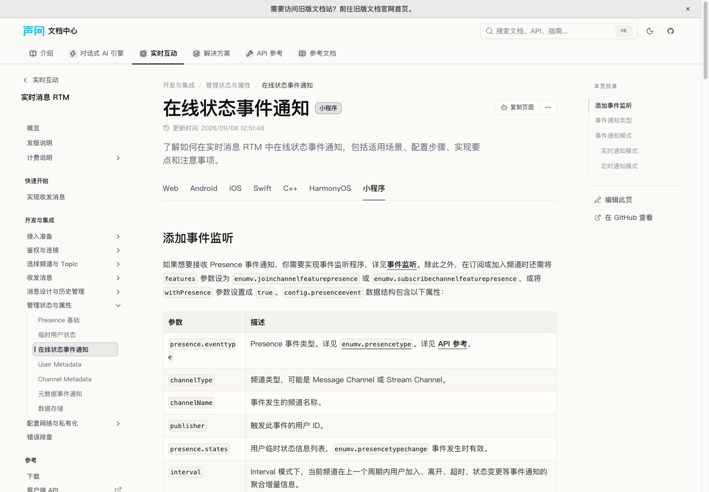
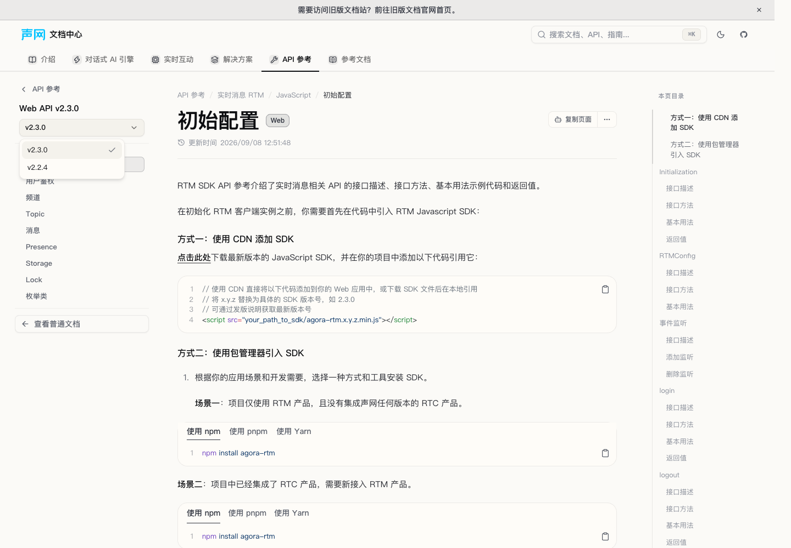

# 源 #2067 RTM Web 2.3.0 完整修复

最终验收：独立双审/单分支full及20修复组合生产构建/UI通过；仅源PR增量验收，不等于全页初次迁移审计完成或已合并/部署。

首次实施状态（历史记录）：READY_WITHOUT_FULL；仅实施者轻量验证完成，独立 spec/quality、主控全量、构建、UI 和 #1229 组合验收待执行。未 push、未建 PR、未合并，不代表线上已生效。

## 固定输入与验收范围

- 源提交：`c8472ac50360d3ed02993fd87ae112ca45c00e2d`（#2067）。
- 源范围终点：`5d03551cf64cd057ccfe8d5b256d9c4778e8fbb1`。
- 目标基线：`7c6c60ead44406e69906c5c3808cd489784aa89e`。
- 审查单位为 `audit_scope=source-pr-delta`：完整23源、52个diff hunk（包括格式/unused import归一化），不是整页重新迁移验收。
- 源仅通过固定对象Git读取；未读源工作区、环境变量文件或未提交改动。未运行面向脏源的全局生成器。
- 19生产文件、3控制CSV、3测试文件、本报告与小型[机器证据](./2026-10-20-hotfix-pr2067-fix.json)。初期准备误报18，正式计划和实现均按19计（包括troubleshooting）。

## 全部 source → target 与处置

| Source | 目标及实际消费者 | 本批结果 |
| --- | --- | --- |
| `docs-api-reference/rtm2/_en/_javascript/_channel-en.javascript.mdx` | CN范围外，不新增英文写集 | 英文4源，保持原处置 |
| `docs-api-reference/rtm2/_en/_javascript/_configuration-en.javascript.mdx` | CN范围外，不新增英文写集 | 英文4源，保持原处置 |
| `docs-api-reference/rtm2/_en/_javascript/_enumv-en.mdx` | CN范围外，不新增英文写集 | 英文4源，保持原处置 |
| `docs-api-reference/rtm2/_platforms_.meta.js` | `content/docs/zh-CN/api-reference/rtm/web/meta.json` | 补版本入口，保留no-redirect |
| `docs-api-reference/rtm2/enumv.javascript.mdx` | `content/docs/zh-CN/api-reference/rtm/web/enumv.mdx` | 补齐本源有效差异 |
| `docs-api-reference/rtm2/toc-channel/channel.javascript.mdx` | `content/docs/zh-CN/api-reference/rtm/web/channel.mdx`；`content/docs/zh-CN/api-reference/rtm/toc-channel/channel.mdx` | 补齐本源有效差异 |
| `docs-api-reference/rtm2/toc-configuration/configuration.javascript.mdx` | `content/docs/zh-CN/api-reference/rtm/web/configuration.mdx`；`content/docs/zh-CN/api-reference/rtm/toc-configuration/configuration.mdx` | 补齐本源有效差异 |
| `docs-faq/rtm2-integration-issue.mdx` | `content/docs/zh-CN/reference/faq/integration/rtm2_integration_issue.mdx` | 补齐本源有效差异 |
| `docs/rtm2/_homepage_.mdx` | `src/components/docs-overview/sdk-downloads-data.zh-cn.ts` | 只修下载数据，保留homepage ignore |
| `docs/rtm2/error-codes.javascript.mdx` | `content/docs/zh-CN/realtime-media/rtm/build/troubleshooting.mdx` | 补齐本源有效差异 |
| `docs/rtm2/get-started/quick-start.javascript.mdx` | `content/docs/zh-CN/realtime-media/rtm/get-started/quick-start.mdx` | 补齐本源有效差异 |
| `docs/rtm2/overview/_release-notes-en.javascript.mdx` | CN范围外，不新增英文写集 | 英文4源，保持原处置 |
| `docs/rtm2/overview/release-notes.javascript.mdx` | `content/docs/zh-CN/realtime-media/rtm/reference/release-notes.mdx` | 终点已覆盖，不改正文 |
| `docs/rtm2/sunset-policy.mdx` | `content/docs/zh-CN/realtime-media/rtm/reference/sunset-policy.mdx` | 补齐本源有效差异 |
| `docs/rtm2/user-guide/channel/message-channel.mdx` | `content/docs/zh-CN/realtime-media/rtm/build/channels-and-topics/message-channel.mdx` | 补齐本源有效差异 |
| `docs/rtm2/user-guide/message/add-event-listener.mdx` | `content/docs/zh-CN/realtime-media/rtm/build/messaging/add-event-listener.mdx` | 补齐本源有效差异 |
| `docs/rtm2/user-guide/presence/event.mdx` | `content/docs/zh-CN/realtime-media/rtm/build/state-and-attributes/presence-events.mdx` | 补齐本源有效差异 |
| `docs/rtm2/user-guide/presence/presence-basic.mdx` | `content/docs/zh-CN/realtime-media/rtm/build/state-and-attributes/presence-basic.mdx` | 补齐本源有效差异 |
| `docs/rtm2/user-guide/presence/temporary-user-state.mdx` | `content/docs/zh-CN/realtime-media/rtm/build/state-and-attributes/temporary-user-state.mdx` | 补齐本源有效差异 |
| `docs/rtm2/user-guide/setup/application-setup.mdx` | `content/docs/zh-CN/realtime-media/rtm/build/rtm-initialization/application-setup.mdx`；`content/docs/zh-CN/realtime-media/rtm/build/network-and-private-deployment/network-configuration.mdx` | 补齐本源有效差异 |
| `docs/rtm2/user-guide/token/user-authentication.javascript.mdx` | `content/docs/zh-CN/realtime-media/rtm/build/authentication-and-connection/user-authentication.mdx` | 补齐本源有效差异 |
| `shared/rtm2/_error-codes.mdx` | `content/docs/zh-CN/realtime-media/rtm/build/troubleshooting.mdx`；`content/docs/zh-CN/realtime-media/rtm/reference/release-notes.mdx` | 补齐本源有效差异 |
| `shared/rtm2/_sdkdownload.mdx` | `content/docs/zh-CN/realtime-media/rtm/get-started/quick-start.mdx`；`content/docs/zh-CN/realtime-media/rtm/build/rtm-initialization/application-setup.mdx`；`content/docs/zh-CN/api-reference/rtm/web/configuration.mdx`；`content/docs/zh-CN/api-reference/rtm/toc-configuration/configuration.mdx` | 补齐本源有效差异 |

## 内容承接细节

### Web当前API和聚合重复副本

canonical `web/configuration` 与仍可路由的 `toc-configuration/configuration` 的javascript块分别补齐：下载2.3.0、Cloud Proxy不自动回退/初始化显式true、7种事件并删status、保留完整linkState事件字段；Presence代码读取 `interval?.totalOccupancy`，新增 `IntervalDetail | null`（仅INTERVAL有值）、join/leave/timeout/userStateList/totalOccupancy五字段及512成员明细与总人数区别、可能短暂延迟；删除监听改linkState。不把HarmonyOS另一个“8种事件”当作Web修改目标。

canonical `web/channel` 与聚合 `toc-channel/channel` 的javascript块都补三断线状态缓存/恢复订阅、Presence异步加入，以及取消未完成订阅返回-11040/随后完成取消/迟到消息不透传。Web enum删除两套旧连接枚举正文；connectionstate与connectionreason旧fragment作为新linkstate/linkstatechangereason语义的兼容别名保留，不再列旧枚举为当前契约。全库反查未见指向Web旧status或两旧枚举fragment的现存内容入站链接；新旧枚举锚点均保留且唯一。

### 指南、FAQ与错误码

Web quick-start两套监听及操作总结、Web Token两套示例、JavaScript listener示例均使用完整八字段linkState：currentState、previousState、serviceType、operation、reason、affectedChannels、timestamp、isResumed。保留源已有 `addEventlistener` 大小写拼写，不夹带源外清理。

message-channel三段新增行为明确属于Web；presence-basic补登录后whoNow/whereNow/远端getState自动等待、无需固定延迟/临时订阅/等Presence事件，以及登出/释放/中断等失败结果。temporary-user-state的Web新增段仅含源Web远端查询等待与正常异步失败，不复制原生额外的远端512查询说明。

Cloud Proxy源setup段的真实目标正文已经拆到network-configuration，新增说明写在该正文；application-setup保留已有跳转，仅更新其JS共享下载展开。

Web troubleshooting错误表新增-10027/RTM_ERROR_DUPLICATE_USER_ID（复用或释放旧实例）、-11040/RTM_ERROR_CHANNEL_SUBSCRIBE_CANCELED（收到订阅结果前取消，随后完成取消）；其他平台同名错误不作为Web覆盖证据。

FAQ仅删除源明确删除的第三问及waitPresenceReady随机临时频道workaround；frontmatter和前两问逐字保持，FAQ文件、导航和FAQ列表数据保留。原filemap完全缺该FAQ key，本批仅补一条既有canonical FAQ映射，不创建页面。

### Presence源重叠与后续覆盖保护

源#2067把javascript加入完整512说明组，并从通用Announce/Interval组移除；终点#2069又把javascript加回通用组，但没有从完整组移除，形成基础段落重复。完整分支原文明说“在现有事件通知模式基础上增加大频道优化”，故本批Web只保留一份完整基础Announce/Interval和8–128范围，然后追加Web2.3.0默认512成员明细优化、totalOccupancy、自动恢复等内容。512不是替代基础8–128切换参数。

mini-program没有追加512，基线所有mini块不变。五原生平台的所有Presence平台块逐字保留。OPEN #1229不在本基线；其独立实现目前Web只有基础块，主控组合时应合成唯一完整Web块、保留mini基础块，并把此前“Web不含512”的负向断言收窄至mini，不能靠无文本冲突判定语义兼容。本分支没有夹#1229的mini新卡、数据或测试。

Web发版说明已包含全部#2067及终点后续“仅一个实例+Demo”增强，整文件不写。源发版8月18日与下载/退休表8月10日是不同字段，原样保留，不擅自统一。发版中的IntervalInfo命名亦未借此改写为API中的IntervalDetail；源内差异与迁移遗漏分开记录。

### SDK与历史API入口

共享SDK下载的JS实际展开闭包为四处：quick-start、application-setup、web/configuration及toc-configuration/javascript，全部改2.3.0。其他原生/RN shared消费者受源平台过滤，不套Web修改。

下载数据只在Web RTM对象头插2.3.0：源原ZIP、MD5 `13f63c0322c49b1edd3f7a0e2c8c89fc`、包agora-rtm、2026年8月10日；两个2.2.4旧对象都去“最新”，所有旧记录及其他平台对象保留。统一目录现有runtime只展示latest/variants，本批不扩大runtime；固定versionIds的真实ProductSdkDownloads消费者验证旧2.2.4 ZIP/MD5/date仍可使用。

正式计划曾误写ZIP host/path为download.shengwang.cn/sdk/release；实施按冻结源纠正为 `https://download.agora.io/rtm2/release/Agora_RTM_JavaScript_SDK_for_Web_v2.3.0.zip`，不猜测包地址。

JavaScript退休表增加2.3.0、2026-08-10、2029-08-11或v2.5.x发布后一年先到为准。

D006按用户2026-10-20批准：历史API只用对应旧站archive外链，当前API/指南在portal补齐。Web meta沿现有navScope设置current2.3.0 path="."和2.2.4固定归档landing：
`https://doc-archive.shengwang.cn/archive/0.0.492/api-ref/rtm2/javascript/toc-configuration/configuration`。
root已通过最终HTTP目的和浏览器页面身份核实为Web2.2.4；实施者未联网复查。保留九pages，不制造本地历史folder、每leaf伪归档映射或新组件。九current页通过真实resolver均识别current；既有resolver的当前版本切换入口落configuration，外部归档也固定landing，本批不修改该runtime行为。

## 控制文件

仅同步15个中文内容源key的canonical target、相关地址和执行状态。先记录in_progress/not_started/pending，内容完成后为completed/ready/pending；独立审查前不写audit pass。source-pr-delta证据不能自动证明旧全页内容完成高保真审计。

英文4源、metadata no-redirect、homepage ignore、shared非页面处置均保持。两个聚合副本及拆出的network正文记录为本批扩展消费者，不制造重复source key。D006原决策在协调审计树尚未合入，本分支仅按批准内容引用，不复制decision文件。

## 已执行轻量验证

- frozen install成功；锁文件无改动。
- 修改前ProductSdkDownloads/SdksCatalog/docs-nav-scope三文件86测试通过。
- 新增首次RED：18内容测试与2真实组件测试共20失败。之后收紧一个JavaScript代码块唯一marker，并纠正“新link-state枚举也允许PRESENCE_NOT_READY”的过宽负向断言；另以冻结基线验证纠正后的listener guard唯一，旧status使回归按预期失败。
- 最终定向四文件107测试通过（新增21；含旧versionIds消费者保护）；版本导航测试覆盖全部九current页。
- `bun run types:check`通过。
- 17个改动MDX完整body按source.config实际Fumadocs preset调用MDX compile全部成功；非仅抽出片段编译。Shiki多实例提示为该逐页独立编译脚本的告警，非编译错误。
- analyzeMdxBuildSyntax逐文件基线对比：48→48，无新增；application-setup与quick-start各24项旧问题不夹改，其余15页0。
- auditDocsLinks限定17个改动MDX：422链接、209hash候选；invalidInternalLinks、invalidLinks、missingHashLinks、missingRootLinks、missingRelativeMarkdownLinks均0。36外链仅识别，不发网络请求。
- 23项范围保护检查通过：5个API/指南改动平台块之外逐字不变，15个原生Presence块族不变，FAQ前两问及frontmatter不变，完整发版说明不变，下载目录旧对象/其他平台除两latest标签外不变。
- 4个TS/test/data文件Biome检查通过；git diff --check通过。
- 未运行full/build/preview；待root独占调度。未执行EN、runtime组件、OpenAPI、CSS、lockfile或生成routeTree修改。

## 交接

主控需完成独立spec→quality审查、版本下拉/下载/Presence真实UI、#1229组合去重与测试范围修正，再串行全量与构建。当前仅READY_WITHOUT_FULL，不等于audit pass、已合入或已发布。

## 2026-10-20 主控后续验收

- 独立规格 `spec2067` 与后续质量 `quality2067` 均PASS，无待修finding。规格审独立复跑107定向、17完整MDX真实preset、422链接209hash、控制行与范围保护。
- 在实施 `117792a2ab` 干净树独占运行 `bun run test --maxWorkers=4`，exit0；222文件、2886项通过、2跳过，175.37秒；日志 `/tmp/docs-portal-pr2067-full-20261020.log`。未改timeout/无关用例，仅既有localstorage warning。
- #1229 两项test-only守卫已另在其独立分支修正并经质量复核：`ccf70995b0` 只禁止mini的512/v2.3.0，`b2f9224ce0` 范围正向仅接受 `[8,128]` 或“8 至 128”。组合树已去除第二份Web基础段，保留一份完整Web基础+优化及mini基础；组合测试仍待最终结果，不能用单分支full代替。
- `addEventlistener` 是源/目标既有拼写债，未夹改；本批测试验证源差异内容而非宣称所有示例均实际SDK执行通过。
- 真实本站UI与20项组合生产build继续由主控串行收口；未合并或部署。

## 主控最终组合生产构建与UI（2026-10-20）

本节基于20修复组合、固定代码 `2dcdf75b2bcd3fcf9cd1e4ac527041ab89f20478`，不是本分支独立production build。无scope types通过；组合full：243文件、3150通过、2跳过，exit0，106.05秒。中文 `VITE_DOCS_REGION=cn bun run build` exit0：6846 payload、8053机器可读、7747路由HTML，client/SSR/全站预渲染完成。chunk体积、插件耗时及Git历史不完整告警保留，没有调阈值或隐藏警告。日志 `/tmp/docs-portal-hotfix20-final-{types,full,build}-20261020.log`。

Web目录卡显示2.3.0、agora-rtm、源MD5/8月10日及agora.io ZIP。Web选中时显示基础模式和512优化，小程序选中时显示[8,128]/Announce/Interval且可见正文不含512；版本菜单2.3.0/外链2.2.4正确。

使用Chrome154专用隔离会话和本地4308生产预览，截图是实际完整构建产物。未下载SDK或执行SDK示例。专用浏览器和预览已关闭，随后无scope types再次通过；后续只增加报告/截图。外站请求结果可能不一致，正确版本身份及早期404证据保留，不承诺永久可用。修复仍需通过PR合入，未部署。

