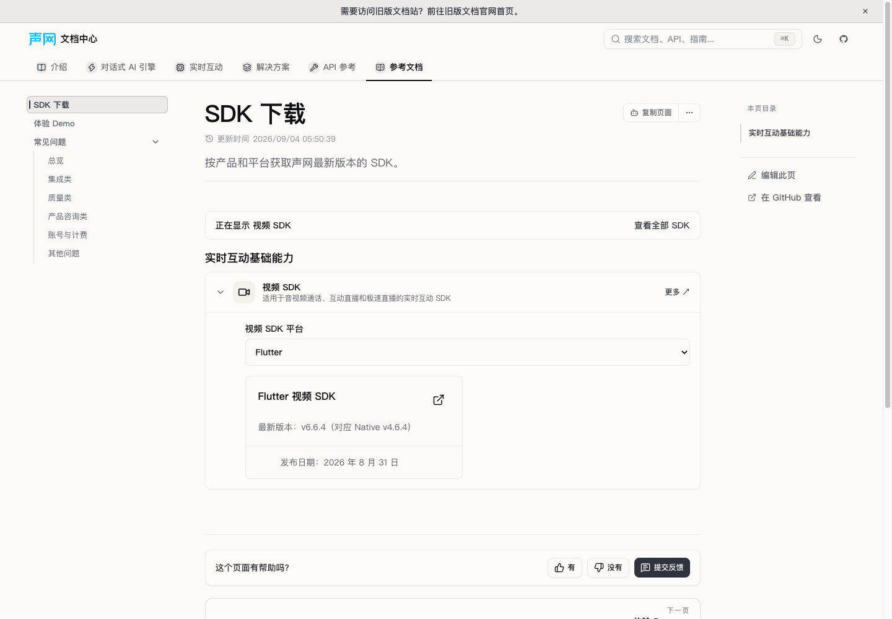
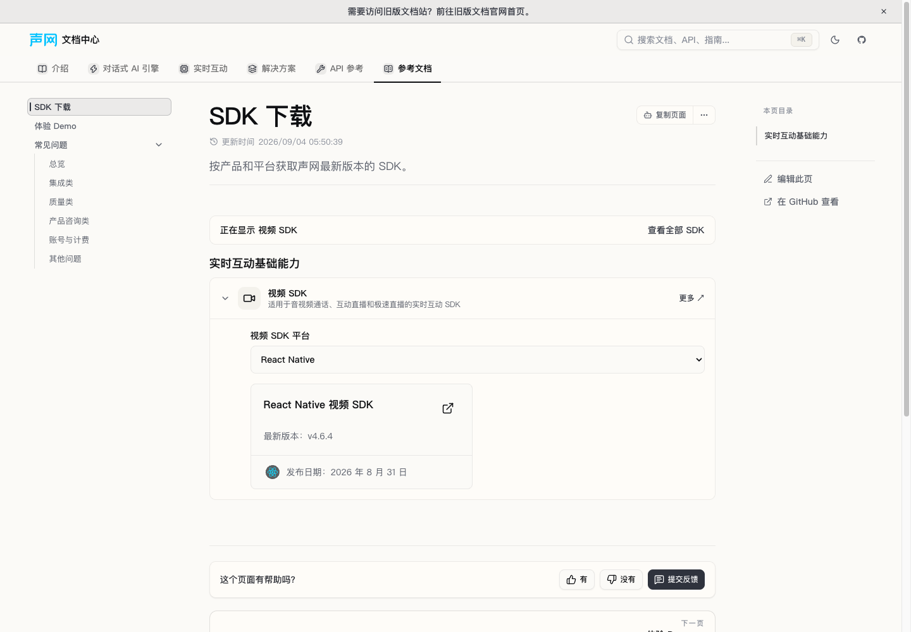
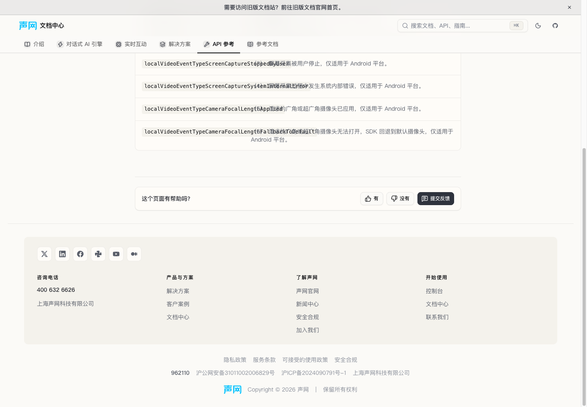
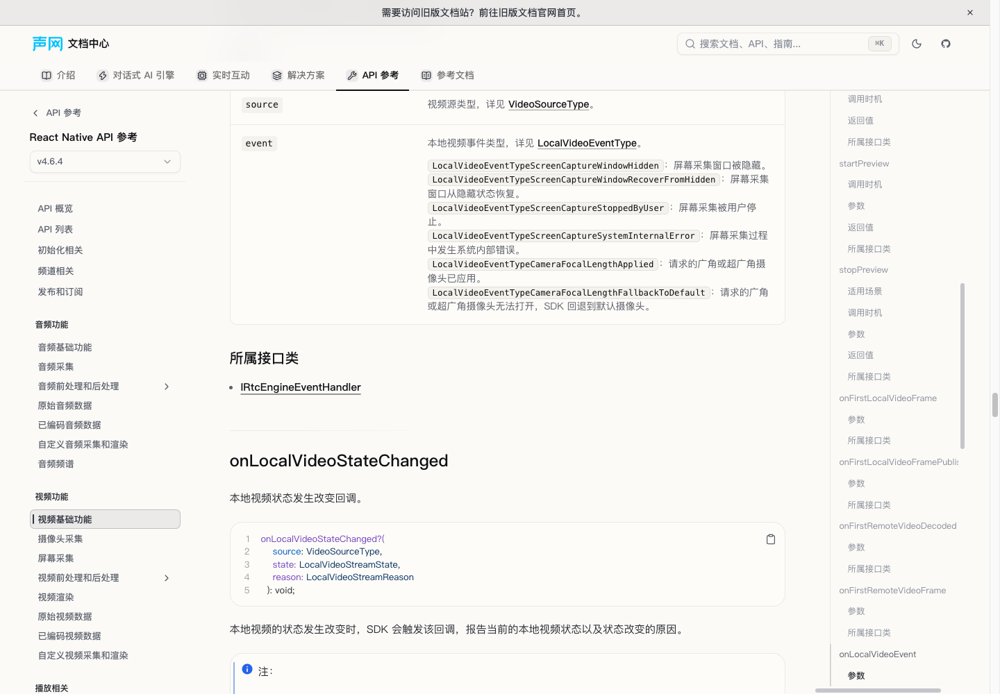

# 源 #2084：Flutter/RN 当前 API 与下载修复

最终验收：独立双审/单分支full及20修复组合生产构建/UI通过；仅源PR增量验收，不等于全页初次迁移审计完成或已合并/部署。

首次实施状态（历史记录）：`READY_WITHOUT_FULL`，等待独立 spec → quality 审查；未 push、未创建 PR、未部署。

## 范围与证据边界

- 源 PR：`2cc6b1b882d37829c45496f9ef3605fed5748285`。
- 冻结终点：`5d03551cf64cd057ccfe8d5b256d9c4778e8fbb1`。
- 目标基线：`7c6c60ead44406e69906c5c3808cd489784aa89e`。
- 工作树：`/Users/yejiayi/.config/superpowers/worktrees/docs-portal/fix-hotfix-pr2084`；分支 `codex/fix-hotfix-pr2084`。实施前 HEAD 与上述基线一致、工作树干净。
- 源根：`/Users/yejiayi/Documents/shengwang-doc-source`；只通过固定对象的 Git show/diff 读取，未读源 env、脏工作树或写源。
- 本批 `audit_scope=source-pr-delta`：只核查源 PR 有效 hunk，不声称对这些已存在页面完成全页初次迁移保真重审。
- 历史 API 已由用户选择旧站 archive 外链（协调决策 D006）；Flutter 6.6.2／RN 4.6.2 的入口及最终 0.0.492 映射由独立 #2113 修复承接。本分支不写版本 meta，也不宣称该独立修复已合入。
- 机器证据：同目录 `2026-10-20-hotfix-pr2084-evidence.json`，含全部 11 源的两时点 SHA-256、逐 hunk 结果、真实目标、原始 nav.toc 和归一化树、锚点、链接、历史数据及 CSV key 保护结果。

以下路径相对本工作树根；`RTC/` 指 `content/docs/zh-CN/realtime-media/rtc/`，`API/` 指 `content/docs/zh-CN/api-reference/rtc/`，`DL/` 指 `src/components/docs-overview/`。

## 完整 11 源 → 目标与有效 hunk

| 源路径 | 真实目标 | 本批结论 |
| --- | --- | --- |
| `docs-api-reference/rtc/_platforms_.meta.js` | `API/flutter/meta.json`、`API/react-native/meta.json` | current 6.6.4／4.6.4 已在；新增旧版入口交独立 #2113。原 .511 在终点已被 .492 替代，不能复制旧映射。保持 no-redirect，不改 meta。 |
| `docs/rtc/_homepage_.mdx` | 旧视觉首页 ignore；`RTC/index.mdx` 的下载入口抵达 `content/docs/zh-CN/reference/sdks.mdx` | 源 RN 从 Electron／Unity 4.6.2 行拆为 4.6.4／8-31；Flutter 改 6.6.4／8-31。新站由独立平台卡等价承接版本、日期与下载，不复活旧 UI。首页入口和发版入口已有，本批修其 catalog 数据。 |
| `docs/rtc/overview/release-notes.android.mdx` | `RTC/reference/release-notes.mdx` Android 块 | 精炼后的“用于通知 Android 广角 / 超广角摄像头采集开启的成功或失败”已在；不重写正文。保留后续 Native 4.7.0。 |
| `docs/rtc/overview/release-notes.flutter.mdx` | 同上 Flutter 块 | v6.6.4／对应 Native4.6.4、8-31、iOS27方向适配和两个 Apple 链接、Android回调说明、13项修复及平台标注均已在。逐条比对13条完整修复原句。源后续删除 macOS15 Beta 已知问题，目标也已删除，不恢复。 |
| `docs/rtc/overview/release-notes.rn.mdx` | 同上 React Native 块 | v4.6.4／8-31、iOS27适配及两个 Apple 链接、Android回调说明、13项修复及平台标注均已在；逐条比对13条完整修复原句。 |
| `docs/rtc/resources.flutter.mdx` | `RTC/reference/downloads/flutter.mdx` → `RtcSdkDownloads` → `DL/sdk-downloads-data.zh-cn.ts` | 前插视频6.6.4、原包管理器路径／versions/6.6.4、8-31；显式 nativeVersion4.6.4 经现 helper 的 versionSuffix 同时显示在专页与 catalog。旧6.6.2仍保留但不再标最新。 |
| `docs/rtc/resources.rn.mdx` | `RTC/reference/downloads/react-native.mdx` → 同共享数据 | 前插视频4.6.4、原 npm 包路径／v/4.6.4、8-31；旧4.6.2保留但不再标最新。两资源页最终换行属非语义变化；示例项目链接未变，均已在目标。 |
| `html-docs/rtc/Flutter/API/enum_localvideoeventtype.html` | `API/flutter/(current)/enum-localvideoeventtype.mdx` | 局部补成员5/6：localVideoEventTypeCameraFocalLengthApplied／FallbackToDefault；保留完整说明及“仅适用于 Android 平台”。 |
| `html-docs/rtc/Flutter/API/toc_video_basic.html` | `API/flutter/(current)/video/video-basic.mdx` | 在 onLocalVideoEvent 的 event Parameter 内补完整6事件列表：4个屏幕采集事件＋2个广角摄像头事件；保留现有枚举链接。 |
| `html-docs/rtc/RN/API/enum_localvideoeventtype.html` | `API/react-native/(current)/enum-localvideoeventtype.mdx` | 同样补5/6与Android范围；RN 标识保留首字母大写 LocalVideoEventType。 |
| `html-docs/rtc/RN/API/toc_video_basic.html` | `API/react-native/(current)/video/video-basic.mdx` | 同样补完整6项，保持 RN 大小写与所有既有回调锚点。 |

四 HTML、两下载、RN 发版在两个源时点 SHA-256 完全相同；它们的缺口不是后续源回退。变化的其余四文件仅体现后续 Native4.7／历史archive映射／Flutter旧已知问题清理等上述已说明覆盖。

## 内容转换、导航与锚点

本批使用既有 `scripts/lib/api-center/html-to-mdx.mjs` 的纯 `convertHtmlToMdx` 和 oxygen 配置，输入仅从固定 Git blob 提取的两个枚举 dt/dd 或单个回调 event dd。输出补丁仅抽取新 Parameter 块及六项 Markdown 列表；不运行全局 generator，不全页刷新。

保留四个旧枚举、全部既有显式 id、参数 source-1/event、回调 prototype/detailed_desc/parameters 和 Since：Flutter6.6.2、RN4.6.1。两个新显式 id 沿当前转换器规则：

- `localvideoeventtypecamerafocallengthapplied`
- `localvideoeventtypecamerafocallengthfallbacktodefault`

原始导航在准备阶段已只读检查，本批机器证据进一步冻结原始串和完整递归树。同平台两 HTML 的导航一致，两个源时点也一致：

| 平台 | 链接数 | 原始字节 | nav.toc SHA-256 |
| --- | --- | --- | --- |
| Flutter | 61 | 4870 | `bf934427c5f9ea7dcc1d70228a43fe114e6cc97af5f3685943a95d028db0a63b` |
| RN | 61 | 4865 | `5aecd90c3328e0921264309a0b6eab673015f61477a01921dc10959445a672ef` |

既有目录仍为“视频功能 → 视频基础功能”，枚举继续由 Class及Enum 索引链接，不额外扁平化导航或新增 meta。

## 源共享消费者与两条下载闭包

固定终点检查 RTC普通文档、RTC共享片段、RTC API MDX／metadata 共425个MDX／JS：没有其他 import 引用这两份资源／两份发版源。RN资源页的 Apiexample import 未被调用；同共享示例片段还被Electron／Web／小程序引用，但源PR没有修改它，下载版本也不从该片段读取，不扩散修改。源两个平台 sidebar 的下载与发版入口、共享示例中的Flutter／RN仓库链接均已核对。

真实目标消费链：

1. `RTC/reference/downloads/{flutter,react-native}.mdx` → `RtcSdkDownloads`：先查RTC专用数据，框架平台不存在于该数据，fallback 到中文共享下载数据。
2. `RTC/index.mdx` 下载动作 → `/zh-CN/reference/sdks?product=video` → `SdksCatalog locale="zh-CN"`：直接查同一中文共享数据。
3. 两条链均使用已有 `getRtcDownloadCardEntries` → `SdkDownloadCard`。可选 `nativeVersion` 只在Flutter新video对象上赋值；既有UnionTech suffix优先，未提供该字段时行为不变。

没有修改 Card／RtcSdkDownloads／SdksCatalog 实现、安装命令解析、下载MDX或发版正文。没有新增组件或CSS，未编造ZIP／MD5／包名或体积来塞Native说明。

共享数据保护对73个产品做深比较：撤去本批两条新对象、还原两条旧label后与固定基线整体相等；两video产品共33条历史版本完整保留。Flutter独立voice仍6.6.2／agora_rtc_engine／3-18；RTM、英文数据和其余平台未改。Native4.7专用数据、#1230八包不在本批写集，不做回滚或合入假设。

## 控制记录

只修改三CSV内本批9个源key：3个发版指向实际统一页；2资源指向实际平台下载页；4HTML从旧defer／空目标修正为现有current目标，并补canonical旧URL、clean新URL与执行行。D002和本次明确用户分配使这4行进入本批；不是把其余HTML泳道整体取消defer。

变更先记录 in_progress/not_started/pending，内容补丁存在后转为 completed/ready/pending。独立审查前不写pass。新增4HTML执行行的completed只表示本次明确source delta已落到已有页面，并非伪造“整页从无到有迁移／整页已审”。

filemap原位修改9行；path-map和ledger各修改5个原有行、追加4HTML行。CSV header、其他源key、顺序和无关引号均保留。metadata仍no-redirect、视觉首页仍ignore。机器证据验证三表的差异key集合均恰好等于这9项；全页待审义务保留。

## TDD 与轻门禁

| 检查 | 实际结果 |
| --- | --- |
| 初始隔离树／冻结安装 | HEAD=固定base且clean；`bun install --frozen-lockfile`退出0，536包，lock未改 |
| 既有下载基线 | 两个consumer文件83通过 |
| 新回归RED | 4文件9失败／85通过；枚举6vs4、参数列表6vs0、两消费链仍旧版、native suffix缺失 |
| 最小GREEN | 4文件94通过（11新增用例含2缺省／UnionTech既有行为守卫） |
| 相关定向扩展 | 7文件121通过 |
| 类型 | `bun run types:check`退出0 |
| 完整MDX实际编译 | 四篇全正文，抽取frontmatter后使用`source.config.ts`实际`docs.docs.mdxOptions()`；输出4193／207902／4193／195871个JS字符串字符，无编译错误 |
| 语法 | 既有analyzeMdxBuildSyntax对四篇0问题 |
| 出站链接 | 既有auditDocsLinks sourcePaths限定四篇：256条root链接、160条hash，invalid／missing root／missing hash均0；未请求外网 |
| 锚点／入站 | 基线全部显式id保留；对中文内容366处指向四目标的片段引用解析成功；新两成员id与参数作用域匹配 |
| 数据保护 | 73产品／33历史video版本深比较通过；保护路径无差异 |
| 控制保护 | 三CSV各恰好9源key差异；非目标key及schema未变；audit仍ready/pending |
| Biome／diff | 仅7个TS／TSX生产及测试文件检查通过；`git diff --check`通过 |

测试命令：

```bash
bun run test src/lib/rtc-pr2084-sync.test.ts src/components/docs-overview/RtcSdkDownloads.test.tsx src/components/docs-overview/SdksCatalog.test.tsx src/components/docs-overview/rtc-download-card-entries.test.ts
bun run test src/lib/rtc-pr2084-sync.test.ts src/components/docs-overview/RtcSdkDownloads.test.tsx src/components/docs-overview/SdksCatalog.test.tsx src/components/docs-overview/rtc-download-card-entries.test.ts src/components/docs-overview/sdk-install-command.test.ts src/components/docs-overview/sdk-download-capabilities.test.ts src/components/docs-overview/sdk-download-page-links.test.ts
bun run types:check
bunx biome check src/lib/rtc-pr2084-sync.test.ts src/components/docs-overview/rtc-download-card-entries.test.ts src/components/docs-overview/RtcSdkDownloads.test.tsx src/components/docs-overview/SdksCatalog.test.tsx src/components/docs-overview/sdk-downloads-data.ts src/components/docs-overview/sdk-downloads-data.zh-cn.ts src/components/docs-overview/rtc-download-card-entries.ts
git diff --check
```

RED在生产代码改动前执行两次；第二次已将列表无匹配转为明确0vs6断言。测试全程存在与基线相同的Node `--localstorage-file`告警，未把它描述为无告警运行。只读保护检查曾尝试用长data URL导入基线纯数据，Bun报NameTooLong；随后改为对可信Git基线的纯常量转译结果内存求值，深比较通过，没有增加文件或绕过未通过的断言。

未执行full全量套件、build、preview、浏览器或外部链接探测；这些由主控串行授权，不能据本报告宣称线上或合并完成。

## 精确写集与交接

生产7文件：四API MDX、`DL/sdk-downloads-data.zh-cn.ts`、`DL/sdk-downloads-data.ts`、`DL/rtc-download-card-entries.ts`。

测试4文件：新`src/lib/rtc-pr2084-sync.test.ts`、新`DL/rtc-download-card-entries.test.ts`、既有`DL/RtcSdkDownloads.test.tsx`及`DL/SdksCatalog.test.tsx`。

记录5文件：三控制CSV、本报告和本批evidence JSON。总计16文件；未扩大生产范围。

交接主控：基于本地提交做source-pr-delta的独立spec后quality，再由主控收口审计状态、full／UI／组合验证。历史入口仍只引用独立#2113；不要把其他已存在页面的全页audit义务改为通过。

## 2026-10-20 主控后续验收

- 独立规格 `spec2084` PASS，另行质量 `quality2084` PASS，无待修finding；规格审独立重跑121定向/types/四完整MDX/256链接160hash及366入站验证均通过。编译输出原报告误称字节，已勘误为JS字符串字符数，未改生产代码。
- 在 `47b3f80ca2` 干净树独占运行 `bun run test --maxWorkers=4`，exit0；223文件、2876项通过、2跳过，104.86秒，日志 `/tmp/docs-portal-pr2084-full-20261020.log`。未调timeout或改无关测试，保留既有localstorage warning。
- 当前阶段为双审/full通过，本站真实UI及最终20项组合生产build待主控继续；不将前十一项旧构建外推覆盖本次。尚未合并或部署。


## 主控最终组合生产构建与UI（2026-10-20）

本节基于20修复组合、固定代码 `2dcdf75b2bcd3fcf9cd1e4ac527041ab89f20478`，不是本分支独立production build。无scope types通过；组合full：243文件、3150通过、2跳过，exit0，106.05秒。中文 `VITE_DOCS_REGION=cn bun run build` exit0：6846 payload、8053机器可读、7747路由HTML，client/SSR/全站预渲染完成。chunk体积、插件耗时及Git历史不完整告警保留，没有调阈值或隐藏警告。日志 `/tmp/docs-portal-hotfix20-final-{types,full,build}-20261020.log`。

Flutter/RN新增枚举与六项回调实际可见；Flutter视频卡显示v6.6.4对应Native v4.6.4，RN为v4.6.4，日期和包地址正确；Flutter独立语音仍6.6.2/agora_rtc_engine/3月18日。

使用Chrome154专用隔离会话和本地4308生产预览，截图是实际完整构建产物。未下载SDK或执行SDK示例。专用浏览器和预览已关闭，随后无scope types再次通过；后续只增加报告/截图。外站请求结果可能不一致，正确版本身份及早期404证据保留，不承诺永久可用。修复仍需通过PR合入，未部署。








