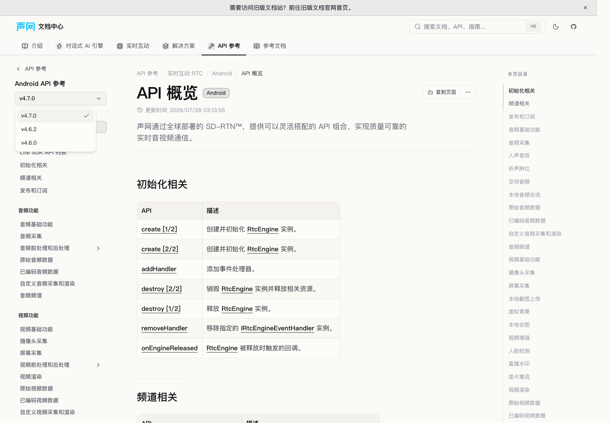
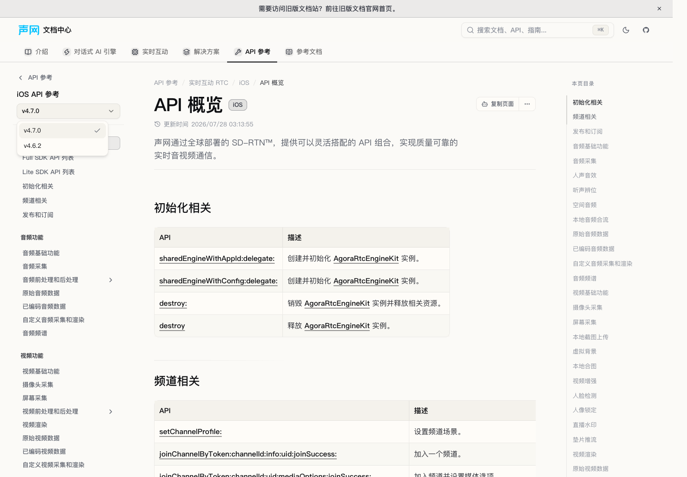
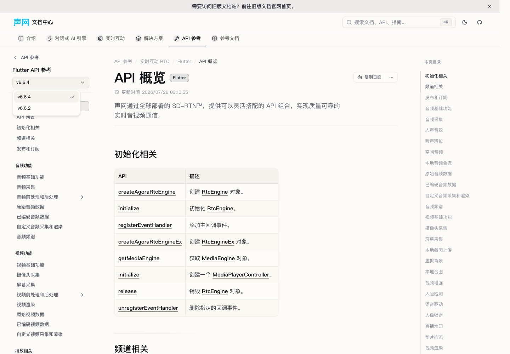
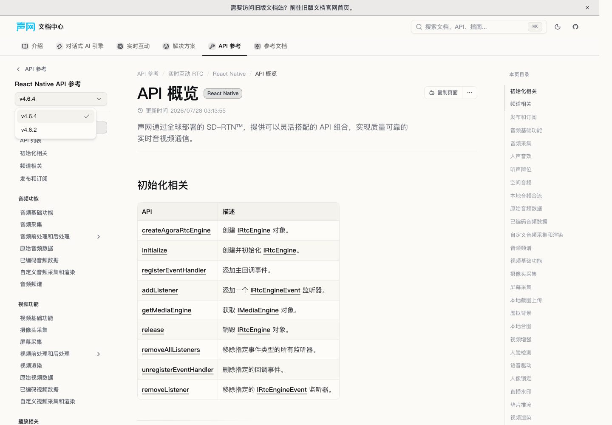
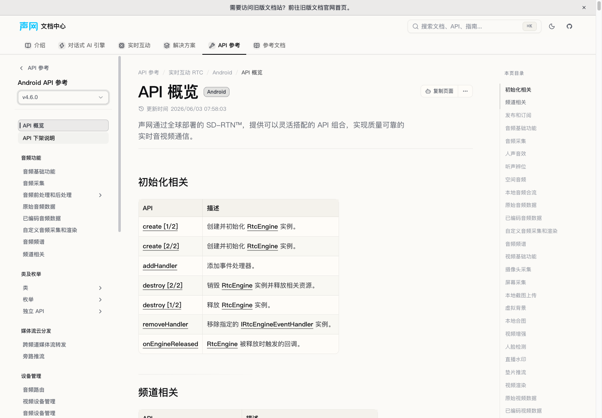

# 源 #2113：RTC 历史 API 归档入口修复

## 范围与状态

- 目标基线：`7c6c60ead44406e69906c5c3808cd489784aa89e`。
- 源提交：`ec0ad467057ed56e4c5059bbccf98b5ce301bb9b`；冻结源终点：`5d03551cf64cd057ccfe8d5b256d9c4778e8fbb1`。
- 用户决策 D006：历史 SDK/API 版本链接旧站对应 archive，不复制归档正文；当前版本 API/指南继续在本站维护。
- 本子任务状态：`READY_WITHOUT_FULL`。定向测试、类型检查及差异检查已通过；修改后的完整回归、规格/质量独立审查与浏览器验收由主控继续安排。
- 源仓库仅通过固定 Git 对象读取，未读取源环境文件或未提交内容，未修改源仓库。本任务未创建 PR、推送、合并或部署。

## 全部源 diff 到目标的映射

源 #2113 仅修改 `docs-api-reference/rtc/_platforms_.meta.js` 一个文件，分类为平台/历史版本导航元数据。全部四个 hunk 都是将历史条目的 `siteVersion` 从 `0.0.511` 改成 `0.0.492`，没有正文、HTML、资产或删除项。

| 源 hunk / 平台 | 历史版本 | 目标 meta |
| --- | --- | --- |
| 第一个 hunk / Android | v4.6.2 | `content/docs/zh-CN/api-reference/rtc/android/meta.json` |
| 第二个 hunk / iOS | v4.6.2 | `content/docs/zh-CN/api-reference/rtc/ios/meta.json` |
| 第三个 hunk / Flutter | v6.6.2 | `content/docs/zh-CN/api-reference/rtc/flutter/meta.json` |
| 第四个 hunk / RN | v4.6.2 | `content/docs/zh-CN/api-reference/rtc/react-native/meta.json` |

四个平台的最终归档映射在冻结源终点仍然存在。本次将它们作为已有 `navScope.versions` 的外链项插入 current 后，而不是短暂恢复错误的 `0.0.511` 地址。

## URL 依据与实际写入值

冻结源中的 `data/constant.ts` 定义 archive 根为 `https://doc-archive.shengwang.cn/archive`；`src/components/versionSelector/ApiVersionSelector.tsx` 从版本元数据读取 `siteVersion`，移除当前 pathname 的站点 baseUrl，再拼接为 `archive/siteVersion/pathname`。`plugins/content-docs.js` 的 API routeBasePath 为 `/api-ref`；平台元数据提供原站 landingPage。这里不使用 `docVersion`，也不使用新站 `/api-reference` 路径。

| 本站平台 | 历史版本 | `href` |
| --- | --- | --- |
| Android | v4.6.2 | `https://doc-archive.shengwang.cn/archive/0.0.492/api-ref/rtc/android/API/rtc_api_overview` |
| iOS | v4.6.2 | `https://doc-archive.shengwang.cn/archive/0.0.492/api-ref/rtc/ios/API/rtc_api_overview` |
| Flutter | v6.6.2 | `https://doc-archive.shengwang.cn/archive/0.0.492/api-ref/rtc/flutter/API/rtc_api_overview` |
| React Native | v4.6.2 | `https://doc-archive.shengwang.cn/archive/0.0.492/api-ref/rtc/rn/API/rtc_api_overview` |

每个新增条目均包含 `id`、`label`、`path`、`href`。其中 `path` 满足现有 schema，但不会加入 `pages`，也没有创建历史版本文件夹。这些链接是对应版本的固定概览入口，不声称支持任意当前叶页到历史叶页的一一映射。

## 保留与去重边界

- Android/iOS current 仍为 v4.7.0，Flutter current 仍为 v6.6.4，React Native current 仍为 v4.6.4。
- 四份 meta 的 `defaultVersion`、原有 current 对象、全部 `pages` 逐字不变；Android 的本站 v4.6.0 入口保留。
- 未修改运行时、英文、当前 API 正文、其他 archive 版本或全局审计 CSV。
- #2085/#2084 最早新增这四个历史入口，本次统一承接 #2113 的最终修正，不重复引入旧地址；#2094 的 `0.0.519` 历史入口不属于本任务。
- 此变更没有创建 redirect，也没有迁移 content page，因此不伪造正文或重定向审计记录。

## 回归证据

新增 `src/lib/rtc-pr2113-archive-sync.test.ts`，12 个测试读取真实四份 meta，经真实 `docsMetaSchema` 解析后校验：

1. 四个归档对象完整相等，包括 RN 旧站 key `rn`、正确 archive 版本与必填 `path`；没有相应本地历史目录。
2. current 标签、默认值、全部页面顺序及 Android 本地 v4.6.0 不变，当前概览正文仍存在。
3. 使用含中文 Reference tab、`(current)` 文件夹和真实概览 URL 的最小 page tree，调用真实 `resolveDocsNavScope`。断言 current 仍为活动版本，sidebar 仍落在 current，版本选择器保留外链，且不需要虚构归档文件夹；Android 本地 v4.6.0 链接继续存在。没有 mock resolver。

测试不锁死完整版本列表，允许后续 #2094 合法增加其他历史选项。

| 检查 | 实际结果 |
| --- | --- |
| `bun install --frozen-lockfile` | 通过，lockfile 未改动。 |
| 修改前独占基线：`bun run test --maxWorkers=4` | exit 0；221 文件通过，2865 测试通过、2 skipped（共 2867），92.49 秒。 |
| RED：`bun run test src/lib/rtc-pr2113-archive-sync.test.ts --maxWorkers=2` | exit 1；8 失败、4 通过。失败均为真实 meta 和真实版本选择器缺少四个归档项。 |
| GREEN：新测试 + `src/lib/docs-nav-scope.test.ts` + `src/lib/docs-meta-schema.test.ts`，`--maxWorkers=2` | exit 0；3 文件、28 测试全部通过。 |
| `bun run types:check` | exit 0。 |
| `bunx --no-install biome check src/lib/rtc-pr2113-archive-sync.test.ts` | exit 0，1 文件，无需修正。 |
| `git diff --check` | exit 0。 |
| 四份 meta 移除新增条目后与固定基线 `deepEqual` | 四份均通过，生产差异仅四份获准 meta、24 行新增。 |

基线日志保留于 `/tmp/docs-portal-pr2113-baseline-20261020.log`，RED/GREEN/typecheck 日志分别为 `/tmp/docs-portal-pr2113-red-20261020.log`、`/tmp/docs-portal-pr2113-green-20261020.log`、`/tmp/docs-portal-pr2113-types-20261020.log`。基线有既有 `localstorage-file` warning 和一次 `socket hang up` stderr，但最终 exit 0；未通过调整 timeout 或修改无关测试消除它们。

## 待主控验收

本子任务未发出联网请求。主控已提供四个 URL 返回 200 且正文平台匹配的结果，但 SSR 未显示版本身份，浏览器核对由主控继续完成；本报告不将其写成四个版本身份均已验证。

修改后的完整回归尚未运行，也未运行 build 或启动 preview。独占基线 full 窗口已在基线结束后释放，后续 full 须由主控重新排队授权。独立规格审查、质量审查及 UI 证据也不在本地定向验证结果中冒充完成。

## 2026-10-20 追加验收：修改后 full 与归档版本身份

本节记录首次交付 `e604b433addfc9a30ecd3fa41a4b379e018fa585` 之后的新证据。上文 `READY_WITHOUT_FULL` 与“完整回归尚未运行、归档版本身份待核对”是首次交付时的状态；以下结果更新这两项，不改动首次交付记录。

主控随后明确授权修改后独占 full 窗口。本子任务在 `e604b433addfc9a30ecd3fa41a4b379e018fa585`、干净工作树上执行唯一一套 `bun run test --maxWorkers=4`：exit 0，222 测试文件全部通过，2877 测试通过、2 skipped（共 2879），耗时 97.94 秒。日志为 `/tmp/docs-portal-pr2113-final-full-20261020.log`。未调整 timeout、未修改无关测试；测试退出后已立即通知主控释放独占窗口。与基线相比，新增 1 个测试文件、12 个通过测试，skip 数不变。

以下联网和浏览器核对由主控于 2026-10-20 完成并提供，不是本子任务自行联网的结果：

| 归档平台 | 主控 curl 结果 | Chrome 154 隔离会话实际渲染的归档版本选择器首个当前版本 |
| --- | --- | --- |
| Android | 最终 HTTP 200，真实 API 概览，平台匹配 | v4.6.2 |
| iOS | 最终 HTTP 200，真实 API 概览，平台匹配 | v4.6.2 |
| Flutter | 最终 HTTP 200，真实 API 概览，平台匹配 | v6.6.2 |
| RN | 最终 HTTP 200，真实 API 概览，平台匹配 | v4.6.2 |

主控确认四个浏览器 URL 均保持上表所列 `0.0.492` 及对应旧站 platform 路径，浏览器会话已关闭。这些证据核对的是归档目的页身份，不等同于已完成本站四个新增下拉选项的本地 UI 验收。

当前交付阶段为修改后完整回归已通过，待主控独立规格审查、质量审查及本站 UI 验收。未运行 build/preview，未 push、创建 PR、合并或部署；本次后续提交只追加本报告，保留首次实现提交不变。

## 主控最终验收（2026-10-20）

- 独立规格审查 `audit_services`、后续独立质量审查 `review_audit` 均通过，无待修finding。生产仍仅四meta的24行新增。
- Chrome154专用隔离会话在本站实际打开四个平台current概览，逐一展开版本下拉并读取真实DOM href：Android/iOS current v4.7.0、Flutter v6.6.4、RN v4.6.4均未变；四新增历史项均为上表准确外链。Android本地v4.6.0仍在。
- 实际点击RN v4.6.2，最终地址为 `https://doc-archive.shengwang.cn/archive/0.0.492/api-ref/rtc/rn/API/rtc_api_overview`，旧站真实API概览显示v4.6.2；不是只检查HTTP200。
- 实际点击Android本站v4.6.0，最终地址 `/zh-CN/api-reference/rtc/android/4.6.0/overview`，页面概览正常，稳定渲染后选择器为v4.6.0。
- 首次窄scope `DOCS_DEV_SCOPE=zh-CN/api-reference/rtc` 裁剪了祖先页面树，版本header不显示；改验证环境为 `DOCS_DEV_SCOPE=zh-CN` 后header及完整站点导航恢复。未因此修改任何产品代码。点击后的即时DOM有短暂前页标签，稳定渲染后正确，不把过渡状态当回归。
- 专用浏览器和4307开发服务器已关闭；随后无scope `bun run types:check` 再次exit0，恢复完整生成树。未运行本分支production build；组合生产build由主控另行验收。

本站截图保留在 `hotfix-pr2113/`：

本分支内容/类型/完整测试/独立双审/本站UI门禁已通过，可提交指定目标分支的独立PR；此状态不表示已合并或部署，也不扩展到其他历史版本外链。
