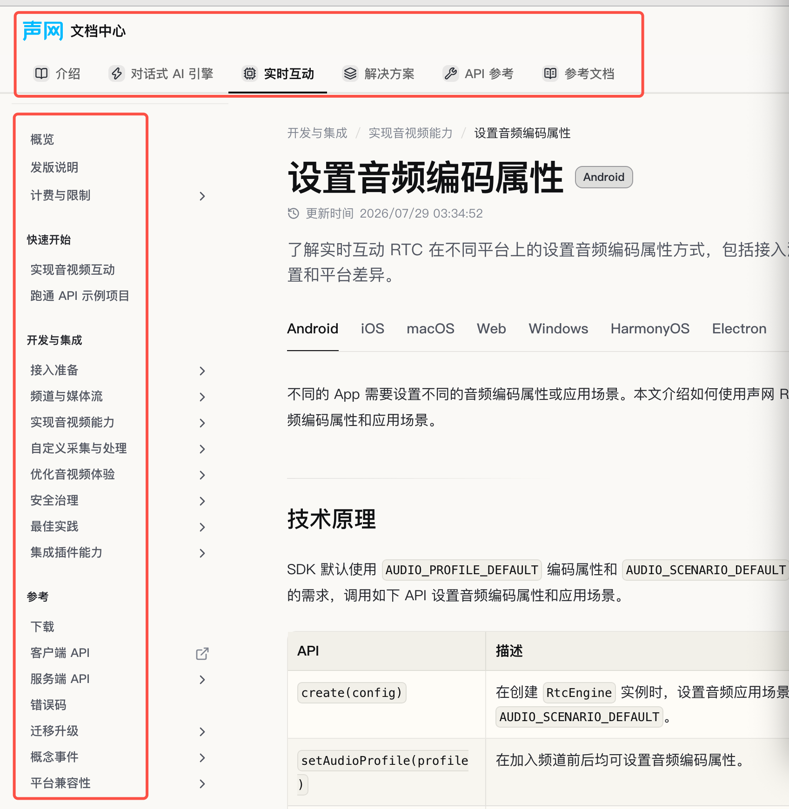
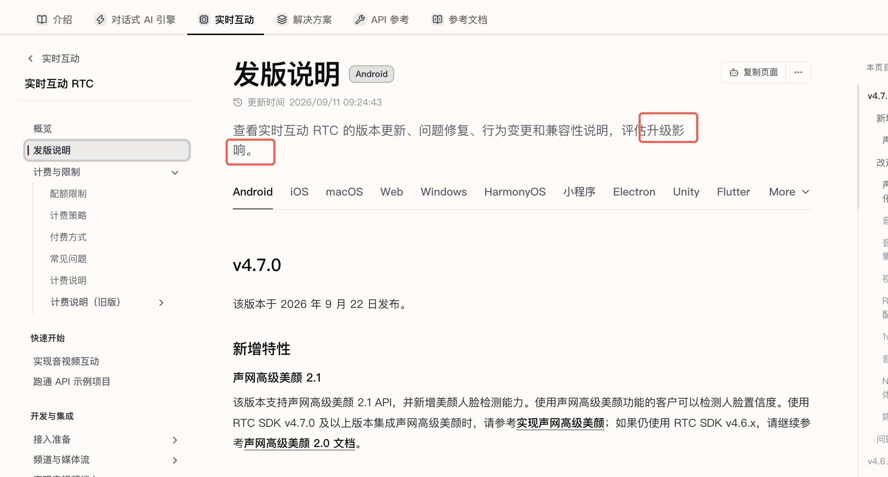
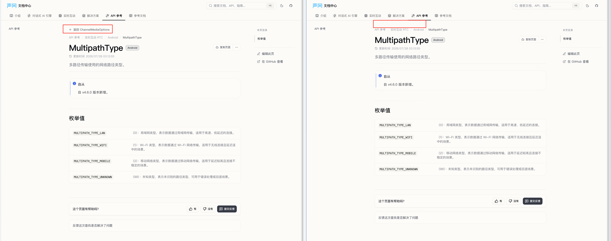

# Staging 网站 UI 反馈研发交接记录

整理日期：2026-10-22。来源：用户提供的 `新 Staging 文档反馈记录.zip`，内含 `新 Staging 文档反馈记录.xlsx`（工作表 `智能表1`）及图片附件。

本记录收录指定的 7 条反馈：ID 3、4、5、6、12、13、36。以下问题描述、反馈人员、登记日期、反馈链接及文档组反馈保留源表原文。类别为整理标签，ID 为原表记录 ID。状态反映附件导出时的记录，供研发交接使用。

这 7 条的「文档对接负责人」均为空，「是否已处理？」均为「否」。「文档组反馈」原文均为：

> 网页设计相关已经统一转交给
> @陈臻 / @余卓朋

原图按 Excel 图片锚点对应到记录，并与压缩包附件逐字节核对。ID 4、6、36 各有 1 张原图，其余记录无附图。图片保持原始文件内容，仅为便于引用重命名。

| 记录 ID | 类别 | 反馈人员（原文） | 登记日期（原文） | 原图数量 |
| --- | --- | --- | --- | --- |
| 3 | 字体颜色 | 杨尚彬(Mills) | 2026年10月20日 | 0 |
| 4 | 字号与层级 | 苏乐雨(Leyu Su) | 2026年10月20日 | 1 |
| 5 | 视觉重点与查找效率 | 王世杰(wangshijie) | 2026年10月20日 | 0 |
| 6 | 换行排版 | 倪晗悦(Olina.Ni) | 2026年10月20日 | 1 |
| 12 | 页面背景 | 苏乐雨(Leyu Su) | 2026年10月20日 | 0 |
| 13 | 顶部布局 | 苏乐雨(Leyu Su) | 2026年10月20日 | 0 |
| 36 | 返回上级与面包屑 | 刘世沁(Jamie) | 2026年10月21日 | 1 |

## ID 3：字体颜色

源表位置：`智能表1!A4:J4`。

- 反馈人员：杨尚彬(Mills)
- 问题登记日期：2026年10月20日
- 文档对接负责人：（原表为空）
- 是否已处理？：否
- 反馈链接：（原表为空）

问题描述（原文）：

> 字体颜色有点浅，还是重一点比较好

图片备注（原图）：

原表与压缩包均无此记录的图片附件。

## ID 4：字号与层级

源表位置：`智能表1!A5:J5`。

- 反馈人员：苏乐雨(Leyu Su)
- 问题登记日期：2026年10月20日
- 文档对接负责人：（原表为空）
- 是否已处理？：否
- 反馈链接：（原表为空）

问题描述（原文）：

> 字太小 & 所有层级字体大小都一样，没有区分度

图片备注（原图）：

原附件路径：`附件下载_新 Staging 文档反馈记录/智能表1/图片备注/字太小 & 所有层级字体大小都一样，没有区分度_企业微信截图_31767c65-b73c-43bc-849f-ab7d3dbaa6e9.png`。

## ID 5：视觉重点与查找效率

源表位置：`智能表1!A6:J6`。

- 反馈人员：王世杰(wangshijie)
- 问题登记日期：2026年10月20日
- 文档对接负责人：（原表为空）
- 是否已处理？：否
- 反馈链接：（原表为空）

问题描述（原文）：

> UI 不够好看，内容不够突出，打开竞品的文档，去找一个东西，能很快看到。反之在我们的文档里要花更多时间找到。

图片备注（原图）：

原表与压缩包均无此记录的图片附件。

以下原因分析、竞品参考及改进建议由用户于 2026-10-22 补充，不属于原反馈表内容。原因分析为推断，待研发结合实际页面验证。

### 三、原因分析（推断，待验证）

| 维度 | 现象 | 对查找效率的影响 |
| --- | --- | --- |
| 文字对比度 | 说明文字可能使用浅灰，中文细笔画在小字号下更显淡 | 扫读时难以辨认 |
| 字号字重 | 卡片说明约 13–14px/400，标题与说明的字重差不明显 | 标题和描述难以区分 |
| 信息层级 | 七八个同级模块，全是“卡片 + 灰字”，没有主次 | 没有视觉落点，只能逐项阅读 |
| 背景明度 | 白底、白卡片、浅边框，明度变化少 | 模块之间缺少分区 |
| 图标与图片 | 页面几乎只有文字，未见图标或插图 | 缺少可快速识别的视觉锚点 |
| 强调色 | 品牌色使用克制，h2 标题本身是链接，可能被弱化 | 重点入口不突出 |
| 主题变量 | 可能存在浅色主题误用灰阶 token 的问题 | 全局性偏淡 |

**结论**：主因是文字对比度和层级设计，其次才是缺少图片和明度变化。

### 四、竞品参考

| 站点 | 可借鉴点 |
| --- | --- |
| Stripe Docs | 深色标题、有分量的 hero 区、层级分明 |
| Vercel Docs | 高对比黑白体系，靠字重和间距建立层级 |
| Twilio Docs | 入口卡片带彩色图标，分区清晰 |
| Supabase / Mintlify 系 | 卡片带图标，品牌色用于图标和 hover |
| 飞书开放平台、腾讯云、阿里云 | hero 区加快速入口卡片，正文深色，说明文字不过浅 |

### 五、改进建议（按优先级）

1. **调整文字色阶**：标题约 `#1f2329`，正文约 `#2b3139`，说明文字不浅于约 `#5b6472`（对比度 ≥ 5:1），并去掉文字上的 `opacity`。
2. **拉开字重和字号差**：卡片标题 600，说明 14px/400，行高 1.6–1.7。
3. **给入口卡片加单色线性图标**，成本低，视觉改善明显。
4. **重做首屏重点**：用大卡片突出“对话式 AI”和“实时互动”两条主线，其余模块降级。
5. **用浅色背景分区**，制造明度变化。
6. **排查主题 token**：确认浅色主题下的次级文字变量没有误用或被透明度压低。

## ID 6：换行排版

源表位置：`智能表1!A7:J7`。

- 反馈人员：倪晗悦(Olina.Ni)
- 问题登记日期：2026年10月20日
- 文档对接负责人：（原表为空）
- 是否已处理？：否
- 反馈链接：[https://docs-portal-staging.sh3.agoralab.co/zh-CN/realtime-media/rtc/reference/release-notes](https://docs-portal-staging.sh3.agoralab.co/zh-CN/realtime-media/rtc/reference/release-notes)

问题描述（原文）：

> 这个地方换行很奇怪

图片备注（原图）：

原附件路径：`附件下载_新 Staging 文档反馈记录/智能表1/图片备注/这个地方换行很奇怪_企业微信截图_4850dfbf-56da-4d25-b8ec-403787fd65df.png`。

### 处理结论（2026-10-22 补充）

经用户确认，序号 6 不作调整，保留现有排版。截图中的换行是文字长度与当前可用宽度恰好相遇时出现的正常情况：就像平时写内容，行尾刚好有一个字放不下，就会换到下一行；窗口宽度或文字内容变化后，断行位置也会改变。因此，这种偶发的断行不作为需要修复的排版问题。

此前尝试的摘要布局和字号修改均已撤回，未提交或推送代码改动。以上为后续处理结论；本节前面的反馈原文及“是否已处理？”字段仍保留源表导出时的记录。

讨论记录：[PR #1274 评论](https://github.com/AgoraIO/docs-portal/pull/1274#issuecomment-6337705709)。

## ID 12：页面背景

源表位置：`智能表1!A13:J13`。

- 反馈人员：苏乐雨(Leyu Su)
- 问题登记日期：2026年10月20日
- 文档对接负责人：（原表为空）
- 是否已处理？：否
- 反馈链接：（原表为空）

问题描述（原文）：

> 灰色底色很奇怪，没见过哪家大厂的文档整体灰底的

图片备注（原图）：

原表与压缩包均无此记录的图片附件。

## ID 13：顶部布局

源表位置：`智能表1!A14:J14`。

- 反馈人员：苏乐雨(Leyu Su)
- 问题登记日期：2026年10月20日
- 文档对接负责人：（原表为空）
- 是否已处理？：否
- 反馈链接：（原表为空）

问题描述（原文）：

> 最上面 声网 文档中心 几个字后的空白太多

图片备注（原图）：

原表与压缩包均无此记录的图片附件。

### 推荐修法（2026-10-22 补充）

参考下图的 LiveKit Docs 顶部布局：第一行左侧放置「声网 文档中心」，中间放置搜索框，右侧集中放置工具入口；第二行横向排列一级导航。利用顶栏中间和右侧区域，减少品牌名称后方的大面积空白。

下图由用户在交接时补充，作为 ID 13 的推荐布局参考；不是原反馈表中的截图。图中具体品牌、栏目名称和工具功能仅作为示例。

## ID 36：返回上级与面包屑

源表位置：`智能表1!A37:J37`。

- 反馈人员：刘世沁(Jamie)
- 问题登记日期：2026年10月21日
- 文档对接负责人：（原表为空）
- 是否已处理？：否
- 反馈链接：[https://docs-portal-staging.sh3.agoralab.co/zh-CN/api-reference/rtc/android/enum-multipathtype](https://docs-portal-staging.sh3.agoralab.co/zh-CN/api-reference/rtc/android/enum-multipathtype)

问题描述（原文）：

> 如果从 https://docs-portal-staging.sh3.agoralab.co/zh-CN/api-reference/rtc/android/channel#%E5%8F%82%E6%95%B0-5 入口一直往下探索，到达最深处时会有返回上级的快速跳转链接。但如果把这个链接复制后用浏览器再打开，就没有这个快速跳转了。
>
> 常见的客户服务场景里，有很多需要和客户介绍某个接口某个参数里的某个结构体中的字段要传什么，但直接给最底层字段页面链接的话，客户读起来不是很方便。老文档无法展示访问跳转的面包屑路径，新文档看起来也没有完全解决这个问题

图片备注（原图）：

原附件路径：`附件下载_新 Staging 文档反馈记录/智能表1/图片备注/如果从 _image.png`。
