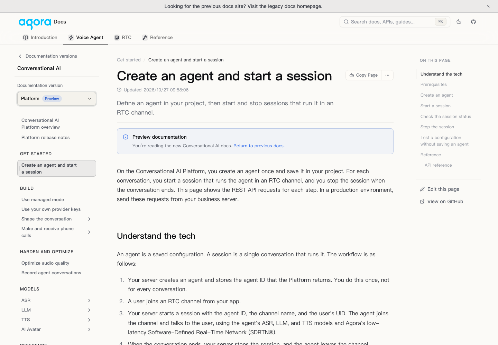
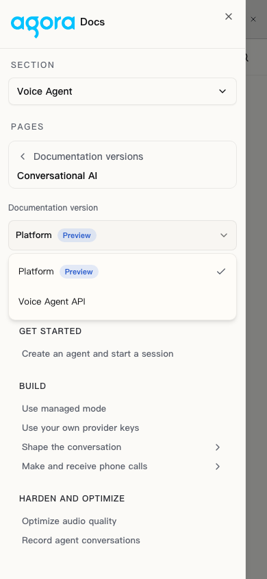

# ENDOC-1074: ConvoAI integrated preview

> Historical snapshot for remote head `26ebbc5f7`, before the October 29
> feedback was applied. Its Preview default, entry placement, SDK behavior
> and release-note anchor statements do not describe the current local work.
> Use the [current local review](2026-10-29-convoai-switcher-local-review.md)
> and [copy audit](2026-10-29-pr1339-copy-audit.md) for the updated behavior.

This integration combines PR #1210 (`codex/api-doc-versioning`) and Saud's PR #1208 (`convoai-v3-openapi`) on current main. Branch: `codex/convoai-switcher-preview`. Review PR: https://github.com/AgoraIO/docs-portal/pull/1339. It is an English review preview, not a production release or a Chinese-branch change.

## Review entry points

Open the preview host at these paths:

- `/en/ai/documentation-versions`: new visitors enter Platform (Preview); returning visitors restore their explicit selection.
- `/en/ai/platform/build/managed-mode`: Platform guide and its own sidebar.
- `/en/ai/build/managed-mode`: Voice Agent guide and its own sidebar, even after selecting Platform elsewhere.
- `/en/api-reference/api-ref/conversational-ai/documentation-versions`: API entry shares the guide preference.
- `/en/ai/platform/release-notes`: separate Platform history.

The existing global catalog/header entry placement is preserved for review. The neutral entry above demonstrates the default behavior without repurposing legacy URLs.

## Implemented behavior

- Production guide/API families reuse #1210's selector, fallback notice, preview notice, fixed-URL metadata and edition exports.
- Explicit sidebar membership enrolls pages; a deferred file's existence cannot make it a switch target.
- Start/stop and personalization guide aliases are explicit. Other shared guide topics map by relative path. Anchors are dropped across versions when no explicit section mapping exists.
- Missing counterparts open the target overview with a visible explanation, as agreed.
- Edition sidebars exclude the other edition and independent products, retaining Pricing and matching REST API links.
- Platform release notes are separate. Legacy release-note URLs and the former Platform section anchors remain valid.
- Preview deployments search their own bundled content using the existing local search provider, so unreleased docs are searchable without changing the production Algolia index. Production provider selection is unchanged. Results carry edition labels through the existing version-aware result renderer.
- Markdown, llms edition indexes/bulk exports and OpenAPI sources remain tied to fixed version URLs.
- `bun run convoai:mapping` regenerates the sidebar manifest. Both `types:check` and `build:static` check for manifest drift.
- Removed two redundant Parameter imports that caused the dynamic production-payload compiler to fail; these primitives are already globally registered.

## Validation

- Focused integration/routing/API/sidebar/export/preference/search-config tests: 148 passed.
- Type checking passed; sidebar manifest check passed.
- The combined upstream baseline had 43 failures; one merge-order expectation was corrected. Final integration run: 42 inherited failures and 1870 passes (1912 tests total). Compared failing test names against the baseline: no new failures.
- Repository lint is not green: existing errors in untouched provider, sitemap/static-manifest and formatting files. Changed implementation files pass focused Biome checks; existing optional-chain warnings remain in the large payload test file.
- Desktop browser: neutral default, direct legacy entry, renamed guide switch, hidden-page fallback, edition sidebars and shared guide/API preference checked. Mobile navigation and switching passed at 390px without horizontal overflow. Local production build passed (2142 route HTML files); generated Markdown/llms/OpenAPI/search artifacts were checked. Remote verification is recorded with the PR delivery.

## Decisions still needed before release

1. Saud: confirm SDK scope and individual API operation mapping. This preview does not infer operation equivalence; switching an operation falls back to the target API overview. Overview/authentication/status pages map where present.
2. Siwei: confirm final global entry/catalog placement, labels, and shared Pricing page behavior. The dedicated neutral review entry is implemented; Pricing remains a shared fixed URL with no edition ownership.
3. Content owner: confirm the deferred Platform content and launch completeness. Existing deferred source files are excluded from edition mappings and edition bulk exports. Their general direct-access/search/publication policy is inherited and still needs a decision; hidden sidebar membership alone is not an access-control rule.
4. Confirm the current release deadline. The earlier Oct 29 target is not a newly confirmed launch commitment.
5. Before production publication, run the normal release-bound search indexing/deployment acceptance, and obtain content, behavior and technical reviews. This integration preview does not publish to production.
