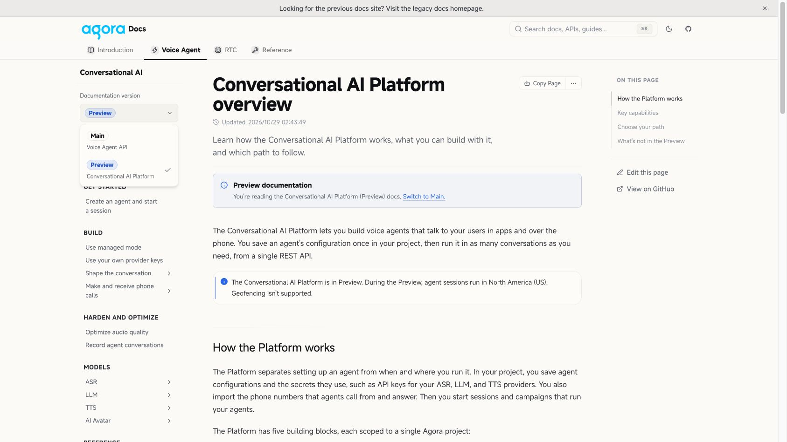

# ConvoAI Main/Preview implementation integration

Integration target: draft PR #1339, branch `codex/convoai-switcher-preview`.
This handoff describes the final implementation. Source-content questions are
recorded for the content owners and do not gate this implementation delivery.

## Upstream refresh

- Main is `ffcfb37bb`; the remote integration snapshot before this follow-up was
  `26ebbc5f7`.
- Merge `8df20dda6` first integrated #1208 at `377b029c3`, including #1340/#1341.
- Merge `0d77a56d7` then integrated #1208 at `fe18eecf3`: updated SDK examples,
  Go installation and resolved SDK notes across 23 files.
- The SDK preview heads match that source update: Python #114 at `ed4466c`,
  TypeScript #124 at `4900f4c`, and Go #117 at `362ce9a`.
- Both merges preserve the source content. The retired Platform Speak, Inject
  context and Interrupt operations remain absent from the source contract and
  generated sidebar. The endpoint registry has 121 entries including samples.

## Implemented behavior

- Real guide, REST and SDK entries default to Main and share the existing
  `convoai` preference key. Isolated samples use `convoai-v3`.
- Main and Preview use the same bordered badge, option check and product
  descriptions in selectors and search. The SDK heading uses the repository's
  Voice Agents name; options identify the two APIs, not two SDK products.
- Ordinary Voice Agent tabs/cards and mobile section entries restore the saved
  choice through neutral entry URLs. Explicit edition links win without
  changing memory. Same-tab and cross-tab subscribers update catalogs while
  explicit document tabs remain pinned.
- Main keeps the existing overview, app, Studio and dedicated-device
  navigation. Preview has its own topics, REST and three SDK links. Main
  release notes retain the main-branch text; the Platform section is displayed
  separately, preserving its source wording.
- Reference has one selector under Voice Agents. On catalog pages it updates
  REST and Python/TypeScript/Go links in place; on an SDK document it switches
  the current language to its counterpart.
- Below 1024px, controls stay inside the collapsed navigation sheet. A document
  selection closes the sheet; an in-place catalog selection keeps it open.
- Preview notices identify Conversational AI Platform (Preview) and provide
  Switch to Main. Missing topics fall back to the selected overview with an
  explanation. Wrapped active navigation titles have a full-height indicator.
- Markdown and full-text exports use the same Main/Preview labels. Internal
  IDs remain in configuration, filtering and stable export URLs.
- Independent groups without a shared key use their group IDs for sidebar
  ownership. A regression covers unrelated groups that both use `v1`.

## Source-content ownership

The [copy audit](2026-10-29-pr1339-copy-audit.md) records source terminology,
placeholder names, deferred behavior and publication questions. At the user's
instruction, the temporary editorial changes to interruption prose, SDK brand
copy, block/stage prose and release dates were withdrawn. Original source text
is preserved from #1208; implementation labels and feature documentation remain
our responsibility. The audit is a record for content owners, not a request for
the user to settle those source questions.

The only original-source path differences from #1208 are the two integration
navigation files, removal of a redundant Parameter import, and the separately
extracted Platform release notes. No API fields or SDK package identifiers were
renamed. Future source updates should continue to flow from the content PR.

## Review paths

The local build is served at `http://127.0.0.1:3022`.

- `/en/ai/documentation-versions`: Main by default or restore saved choice.
- `/en/ai`: complete Main navigation.
- `/en/ai/platform`: Preview notice, scoped navigation and SDK links.
- `/en/api-reference`: shared REST/SDK catalog control under Voice Agents.
- `/en/api-reference/api-ref/conversational-ai/documentation-versions`: shared
  REST entry preference.
- `/en/api-reference/api-ref/server-sdk/platform/go`: same-language switching.
- `/en/ai/build/start-stop-agent`: renamed-topic mapping.
- `/en/ai/get-started/quickstart`: missing-counterpart fallback.

## Verification

- Independent implementation review found a keyless-group sidebar isolation
  issue and a bulk-export label mismatch; both are corrected.
- The targeted post-review regression run passed 20 tests.
- Final full suite: 1888 passed / 42 failed (1930 total). Failed test names
  exactly match the pre-follow-up baseline; there are no newly failing tests.
- Final type checking and changed-source Biome checks passed. Existing
  full-repository lint errors remain outside this implementation.
- Production build passed with 2143 route HTML files. All six real bulk exports
  identify Main/Preview by label. Published OpenAPI and all three source SDK
  references match the latest #1208 byte-for-byte. Platform release-note prose
  matches its source section, and Main release notes match main.
- Final browser checks cover Reference in-place selection, Preview SDK notice,
  same-language SDK switching, ordinary guide preference restoration, and
  explicit Preview links that leave the saved Main choice unchanged.
- At a 391px CSS viewport, the guide selector is inside the mobile navigation
  sheet. Document switching closes the sheet; Reference catalog switching keeps
  it open and remaps SDK links. No horizontal document overflow or runtime
  errors appeared in these checks. This is browser emulation, not a physical
  device test.

[Reference catalog](convoai-switcher-preview/unified-reference.jpg) ·
[Mobile navigation](convoai-switcher-preview/unified-mobile.jpg)

## Delivery scope

Only the integration branch is pushed and the PR remains draft. Source-content
publication, production search indexing and promotion from Preview to Main
remain outside this implementation delivery. Configuration and usage are
maintained in [Documentation Preview and versions](../../doc-versioning.md).
